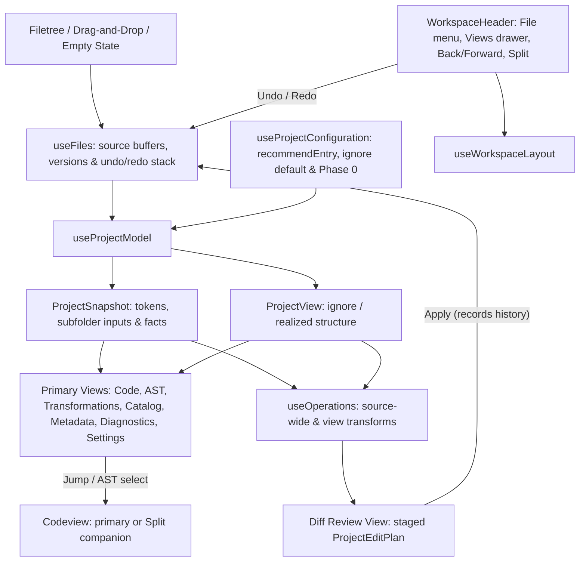

# Website architecture

This document describes the website using `@preptex/core@0.6.2`. Update it when
component responsibilities, state ownership, or the integration contract change.

## Scope and dependencies

This is a client-only React application. It loads virtual files (including nested subfolders
and drag-and-drop folders filtered by relevant TeX extensions), displays LaTeX source, renders whole-document (`ignore` conditionals),
entry-only `\input` (`command` default) or recursive/inlined project views, condition-free configured structure, or lossless source tokens, provides standalone condition
realization (Pipeline B), `\input` expansion/flattening (`expand-inputs`), independent analyses (references, command definitions/usage),
whole-document and single-branch transformations, staged diff review with undo/redo history, and
ZIP/file downloads. There is no backend, persistence service, TeX compiler, PDF renderer, or
network file service. Files live in memory; only AST filter preferences persist in browser
`localStorage`.

Runtime dependencies are React 19, CodeMirror 6, and PrepTeX Core 0.6.2.
The build system is Create React App 5 with TypeScript 4.9 and Webpack 5.
TypeScript uses ES2020, strict checking, checked indexed access, and Node module
resolution compatible with that compiler. Explicit `any` is an ESLint error.
Jest transforms the ESM PrepTeX package and CodeMirror's ESM
`@marijn/find-cluster-break` dependency.

## Components and classes

| Component or class | Location | Responsibility |
| --- | --- | --- |
| `App` | `src/App.tsx` | Single-workspace shell with top `WorkspaceHeader`, collapsible left `Filetree` sidebar, primary view switcher (`Code`, `AST`, `Transformations`, `Catalog`, `Metadata`, `Diagnostics`, `Diff Review`, `Settings`), and optional `Split` companion pane (off by default). |
| `WorkspaceHeader` | `src/components/WorkspaceHeader.tsx` | Compact top bar displaying the PrepTeX logo + wordmark alongside a continuous `File` / `Edit` (Undo/Redo arrows, Transformations, Diff Review, Settings) / `View` (all workspace views drawer + Split/Explorer toggles) menubar strip, plus right-side diff/diagnostic alert pills and entry readiness indicator. |
| `WelcomeEmptyState` | `src/components/WelcomeEmptyState.tsx` | Centered empty-workspace onboarding dropzone supporting file/folder upload, drag-and-drop directories, and demo project loading. |
| `Filetree` | `src/components/Filetree.tsx` | Left sidebar explorer with nested folder hierarchy, live path filtering, expand/collapse-all folders, inline file/subfolder creation, `Entry` badge + `Set as entry`, drag-and-drop traversal (`src/utils/dropEntries.ts`), downloads, and removal. |
| `OperationsDialog` & `ControlPanel` | `src/components/OperationsDialog.tsx`, `src/components/ControlPanel.tsx` | Transformations view with expandable/activatable code-modifying boxes (`Realize Conditions`, `Suppress Comments`, `Remove Environments`, `Expand / Flatten \input`) and a single unified Apply panel choosing between in-place Diff Review or outputting new file(s) (optionally into a subfolder via `src/utils/transformOutput.ts`), plus generated artifact downloads. |
| `ASTview` | `src/components/astview/ASTview.tsx` | Structural tree view (`Coarse`, `Structure`, `Source` modes) with quick `\input` handling toggle (`Command` entry-only vs `Recursive`), non-halting missing-`\input` warning banner, lazy inline Phase 0 condition configuration when conditionals exist, AST node filtering, `NodeActionBar`, and `Split` companion toggle. |
| `CatalogDialog` | `src/components/CatalogDialog.tsx` | Commands, environments, conditions, labels, and citations inspector with occurrence jumping, `target: 'source'` refactoring (scoped by entry/recursive mode), inline definition editing, and custom signature reparsing. |
| `MetadataDialog` | `src/components/MetadataDialog.tsx` | Title, authors, date, abstract, preamble packages, bibliography info, and project statistics with direct edit diff staging and source jumping. |
| `LogDialog` & `LogPanel` | `src/components/LogDialog.tsx`, `src/components/LogPanel.tsx` | Diagnostics and analysis findings view merging project and transformation warnings/errors with `Check References` and `Check Commands` actions, error banners, stale indicators, and clickable source jump links. |
| `EditPreviewDialog` | `src/components/EditPreviewDialog.tsx` | Full-pane Diff Review view (also supports `variant="dialog"` for unit tests) displaying file/line diffs, stale alerts, Discard, and atomic Apply that records transformation history. |
| `ProjectSetupDialog` | `src/components/ProjectSetupDialog.tsx` | Settings view (also supports `variant="dialog"` for unit tests) configuring entry file, `\input` handling (`command` default, `recursive`, `inline`) & traversal, condition policy (`ignore` default, `source`, `source-with-overrides`, `manual`, `none`), split preference, and custom signatures. |
| `NodeActionBar` | `src/components/NodeActionBar.tsx` | Contextual action strip above `ASTview` for removing, wrapping, unwrapping, or renaming selected AST nodes. |
| `Codeview` | `src/components/Codeview.tsx` | Read-only CodeMirror 6 wrapper supporting document switching and precise line/UTF-16 range jumping. |

## Hooks, services, and state ownership

| Hook or service | State or contract | Role |
| --- | --- | --- |
| `useFiles` | Reducer owning `FilesMap`, monotonic `sourceRevision`, monotonic `fileVersions`, `selectedFile`, `uploadNotice`, and bounded undo/redo history stacks (`past`, `future`). | Filters uploaded folders before reading (via `src/utils/fileFilter.ts`), normalizes uploaded folder batches (stripping shared root wrappers), manages create/upsert/remove/reset, and supports `goBack()`/`goForward()` with advancing versions. |
| `useWorkspaceLayout` | `activeView`, `previousView`, `splitEnabled` (`false` default), `sidebarCollapsed`, `openMenu`. | Owns single-viewport navigation, `File`/`Views` dropdown state, Split side-by-side companion visibility, and clean return from `Diff Review`. |
| `useProjectConfiguration` | `entryPath`, `traversal`, `inputs` (`'command'` default), `conditionPolicy` (App initializes with `{ mode: 'ignore' }`), `customCommands`, `coarseTreeOptions`, `revision`. | Owns stable entry, `\input` handling mode, traversal, and condition evaluation configuration decoupled from active viewer file; exposes `recommendEntry()`. |
| `useProjectModel` | `snapshot`, `view`, `coarseTree`, `catalog`, `metadata`, `hasConditionals`, `detectedConditions`, `issues`, `viewIssue`, `isReady`, `error`. | Maintains incremental immutable `ProjectSnapshot`, derives `ProjectView` (defaulting to `'ignore'` conditionals and `'command'` `\input` handling), and derives `catalog`/`metadata` without halting on missing inputs. |
| `useOperations` | `result`, `pendingEditPlan`, `conditionRealization`, `artifacts`, `transformationIssues`, `isStale`, `isEditPlanStale`, capabilities. | Supports both snapshot/entry-scoped (`target: 'source'`) and view-scoped transformations including `expand-inputs`, condition realization (Pipeline B), analyses, composable pipelines, non-halting warning collection, and edit validation/application. |
| `useControl` | `CoreOptionsUI` (`suppressComments`, `suppressCommentEnvironments`, `inputHandling`, `stripDeclarationsAndSetters`, `outputName`). | Owns export and condition-realization options. |
| `src/utils/fileFilter.ts` | `RELEVANT_TEX_EXTENSIONS`, `IGNORED_FOLDER_SEGMENTS`, `filterUploadedBatch` | Filters folder/directory upload batches to relevant TeX project files while ignoring VCS/build directories and non-TeX binaries. |
| `src/utils/dropEntries.ts` | `extractDroppedFiles` | Recursively flattens drag-and-drop directory entries while tagging directory-originated items and preserving relative virtual paths. |
| `src/services/zip.ts` | Zero-dependency PKZIP 2.0 archive builder | Packages project files or artifacts into `.zip` downloads. |
| `src/services/core.ts` | Pure adapters for `@preptex/core@0.6.2` | Stateless tokenization, snapshot updates, condition realization, view resolution, composite pipelines, analyses, and typed `ProcessingError` mapping. |

## Data flow



## PrepTeX integration contract

Import public values and types only from `@preptex/core`.
Core results are deeply frozen and readonly. Never mutate core objects or cast away readonly.
Source ranges are inclusive UTF-16 offsets and one-based lines.
They are translated to CodeMirror half-open coordinates at the display boundary in `Codeview`.

## Checks

Use Node.js 22 and npm. Before concluding changes, run:
```sh
npm run typecheck
npm run lint
npm run test:ci
npm run build
```
