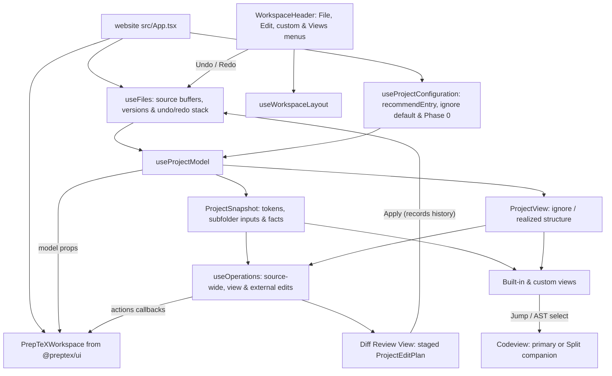

# Website architecture

This document describes the website using `@preptex/core@0.6.2` and `@preptex/ui@0.1.0`. Update it when
component responsibilities, state ownership, or the integration contract change.

## Scope and dependencies

This is a client-only React application. It computes `@preptex/core` snapshots, configured views, analyses,
and edit plans locally in the browser and renders them via `<PrepTeXWorkspace>` from `@preptex/ui`, which
handles virtual files (including nested subfolders and drag-and-drop folders filtered by relevant TeX
extensions), LaTeX source display, whole-document (`ignore` conditionals), entry-only `\input` (`command`
default) or recursive/inlined project views, condition-free configured structure, lossless source tokens,
standalone condition realization (Pipeline B), `\input` expansion/flattening (`expand-inputs`),
independent analyses (references, command definitions/usage), whole-document and single-branch
transformations, staged diff review with undo/redo history, and ZIP/file downloads. There is no backend,
persistence service, TeX compiler, PDF renderer, or network file service. Files live in memory; only AST
filter preferences persist in browser `localStorage`.

Runtime dependencies are React 19, CodeMirror 6, PrepTeX Core 0.6.2, and `@preptex/ui`.
The build system is Create React App 5 with TypeScript 4.9 and Webpack 5.
TypeScript uses ES2020, strict checking, checked indexed access, and Node module
resolution compatible with that compiler. Explicit `any` is an ESLint error.
Jest transforms the ESM PrepTeX packages (`@preptex/core`, `@preptex/ui`) and CodeMirror's ESM
`@marijn/find-cluster-break` dependency.

## Components and package boundary

| Layer | Location | Responsibility |
| --- | --- | --- |
| `App` | `src/App.tsx` | Connects browser file/config/layout hooks (`useFiles`, `useProjectConfiguration`, `useWorkspaceLayout`, `useControl`) and local `@preptex/core` hooks (`useProjectModel`, `useOperations`) to `<PrepTeXWorkspace>` via `model` and `actions`. |
| `index` | `src/index.tsx` | Imports `@preptex/ui/tokens.css`, app overrides (`src/index.css`), and mounts `<App />`. |
| Core model & services | `src/model/useProjectModel.ts`, `src/model/useOperations.ts`, `src/model/useSourceIndex.ts`, `src/services/core.ts` | Client-side `@preptex/core` execution layer: incremental `ProjectSnapshot`, `ProjectView`, coarse trees, symbol catalog, metadata extraction, analyses, and transformation/edit-plan application. |
| `@preptex/ui` | External package (`../ui` during local development via `npm run ui:link`) | Pure React UI (zero runtime `@preptex/core` calls): `PrepTeXWorkspace`, `WorkspaceSessionContext`, `WorkspaceHeader`, `WelcomeEmptyState`, `Filetree`, `OperationsDialog`, `ControlPanel`, `ASTview`, `CatalogDialog`, `MetadataDialog`, `LogDialog`, `LogPanel`, `EditPreviewDialog`, `ProjectSetupDialog`, `NodeActionBar`, `Codeview`, state hooks (`useFiles`, `useWorkspaceLayout`, `useProjectConfiguration`, `useArtifacts`, `useControl`), ZIP builder, and CSS tokens. |

## Data flow



## PrepTeX integration contract

Import public values and types only from `@preptex/core` and `@preptex/ui`.
Core results are deeply frozen and readonly. Never mutate core objects or cast away readonly.
Source ranges are inclusive UTF-16 offsets and one-based lines.
They are translated to CodeMirror half-open coordinates at the display boundary in `Codeview`.

## Checks

Use Node.js 22 and npm. Before concluding changes, run:
```sh
npm run check:core-link
npm run check:ui-link
npm run typecheck
npm run lint
npm run test:ci
npm run build
```
