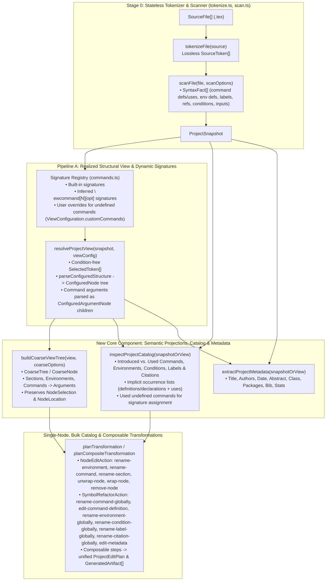

# PrepTeX Core (`@preptex/core@0.5.0`) Implementation Plan: Coarse View Tree, Argument Child Nodes, Symbol Catalog, Dynamic Reparsing, Metadata & Composable Refactorings

Status: **Proposed Core Library Implementation Specification (`@preptex/core@0.5.0`)**
Prepared: 2026-11-16
Baseline: `@preptex/core@0.4.0`

---

## 1. Goal and Architectural Evolution

This plan moves `@preptex/core` into its next phase by introducing a **Semantic Inspection, Catalog & Refactoring Layer** on top of the existing Stage 0 (Stateless Tokenizer), Pipeline B (Condition Realizer), and Pipeline A (Condition-Free Structural Parser):

1. **Structured Command & Environment Arguments as Child Nodes (`ConfiguredArgumentNode`)**:
   - Command, section, and environment arguments (`[optional]` and `{mandatory}` or single-token arguments) become first-class `ConfiguredArgumentNode` (`kind: 'argument'`) child nodes in the tree rather than flat token slices.
2. **Coarse View Tree (`CoarseTree` & `buildCoarseViewTree`)**:
   - A dedicated core projection (`src/lib/project/coarse-tree.ts`) derives a human-readable structural tree (`CoarseNode`) from `ProjectView`. It strips low-level lexical clutter (`space`, raw `{`/`}`/`[`/`]` delimiters, redundant leading command tokens, and ungrouped prose tokens), surfaces `section`, `environment`, `command` (with `argument` children), and `math` structures, and preserves exact `NodeSelection` / `NodeLocation` provenance so every coarse node is directly selectable and editable.
3. **Dynamic Command Signatures & Reparsing (`CustomCommandSignature` & Definition Inference)**:
   - Automatically infers `[numArgs][default]` signatures from reached `\newcommand`, `\renewcommand`, `\providecommand`, and `\def` declarations.
   - Accepts user-specified `customCommands: readonly CustomCommandSignature[]` in `ViewConfiguration` (and `ScanOptions`) so any **used undefined command** can be assigned a number of mandatory and optional arguments and immediately **reparsed** into a `ConfiguredCommandNode` with `argument` child nodes.
4. **Project Symbol & Construct Catalog (`inspectProjectCatalog`)**:
   - Produces a comprehensive inventory of all **introduced (defined/declared)** and **used** **commands**, **environments**, **conditions**, **labels/references**, and **citations** across the project or realized view.
   - Maintains an indexed, deterministic list of **all occurrences** (both definition/declaration sites and usage sites) for every command, environment, condition, label key, and citation key.
5. **Single-Node & Bulk Catalog Refactorings (`refactor.ts` & Extended `NodeEditAction`)**:
   - **Single-node edits**: Rename an environment (`\begin{...}` and `\end{...}`, even when arguments follow `\begin`), rename a single command occurrence (`\old` $\rightarrow$ `\new` preserving `*` and arguments), change a section level, unwrap a container, wrap a node, or remove a node.
   - **Bulk catalog edits**:
     - Rename a command across **all occurrences** and its `\newcommand`/`\def` definition(s);
     - Edit a `\newcommand` definition (name, argument count, optional default, or body);
     - Rename an environment across **all occurrences** and its `\newenvironment`/`\newtheorem` definition(s);
     - Rename a boolean condition across its `\newif` declaration, `\if...` tests, and `\Xtrue`/`\Xfalse` setters;
     - Rename a **label key** across all `\label{key}` declarations and all `\ref`/`\eqref`/`\pageref`/`\autoref`/`\cref`/`\Cref` occurrences (`rename-label-globally`);
     - Rename a **citation key** across `\bibitem{key}` definitions and all `\cite`/`\citet`/`\citep` occurrences, including inside comma-separated `\cite{a,b,c}` lists (`rename-citation-globally`).
6. **Document Metadata Extraction & Direct Editing (`extractProjectMetadata` & `edit-metadata`)**:
   - Extracts structured document metadata (`title`, `authors`, `date`, `abstract`, `documentClass`, `packages`, `bibliography`, `keywords`, and structural statistics) with source locations and AST node keys, and supports direct in-place editing of `title`, `author`, `date`, and `abstract` via `ProjectEditPlan`.
7. **Composable Multi-Step Transformation Pipeline (`planCompositeTransformation`)**:
   - Chains an ordered sequence of refactoring and cleanup steps (`realize-conditions` $\rightarrow$ `refactor-symbols` $\rightarrow$ `edit-nodes` $\rightarrow$ `suppress-comments` $\rightarrow$ `remove-environments` $\rightarrow$ `export-project`) over virtual snapshots/views and composes intermediate edits back to original `ProjectSnapshot` coordinates to emit a single unified `ProjectEditPlan` and final `GeneratedArtifact[]`.

---

## 2. Updated Core Architecture & Data Flow



---

## 3. Phase-by-Phase Core Implementation Specification

### Phase C1: Command Arguments as Explicit Child Nodes & Dynamic Command Signatures (`src/project-types.ts`, `src/lib/project/commands.ts`, `src/lib/project/structure.ts`)

#### 3.1.1 Explicit `ConfiguredArgumentNode` in `ConfiguredContainerNode`
Update `ConfiguredContainerNode` in `src/project-types.ts` to include `'argument'`:
```ts
export type ConfiguredArgumentDelimiter = 'braced' | 'bracket' | 'bare';

export type ConfiguredArgumentNode = ConfiguredNodeBase & {
  /** Argument container variant. */
  readonly kind: 'argument';
  /** Argument role in the parent signature. */
  readonly argKind: 'optional' | 'mandatory';
  /** Zero-based parameter slot index in the parent signature. */
  readonly slot: number;
  /** Whether interior tokens are non-executed opaque leaves. */
  readonly opaque: boolean;
  /** Enclosing delimiter syntax in source. */
  readonly delimiter: ConfiguredArgumentDelimiter;
  /** Original extent of the interior content alone (`kind: 'none'` for empty delimiters). */
  readonly innerLocation: NodeLocation;
  /** Inclusive range of the interior content in the virtual token tape. */
  readonly innerProjectedRange: SourceRange;
  /** Ordered child nodes: opening delimiter leaf (if delimited), interior nodes, closing delimiter leaf (if delimited). */
  readonly children: readonly ConfiguredNode[];
};
```
- In `parseConfiguredStructure` (`src/lib/project/structure.ts`):
  - When `finalizeDelimitedArgument` or `recordSingleNodeArgument` completes an argument on a `command`, `section`, or `environment` frame:
    - Construct a `ConfiguredArgumentNode` (`kind: 'argument'`) whose `children` are `[openLeaf, ...argChildren, closeLeaf]` (for braced/bracket arguments) or `[singleNode]` (for bare single-token arguments).
    - Push that `ConfiguredArgumentNode` into `parent.children`!
    - Keep `parent.arguments: readonly ConfiguredCommandArgument[]` populated with `childStart === childEnd === argNodeIndex` (pointing directly to the `ConfiguredArgumentNode` in `parent.children`) for backward compatibility.
  - Also parse optional/mandatory arguments immediately following `\begin{env}` on `environment` nodes (e.g., `\begin{theorem}[Main Result]`, `\begin{tabular}[t]{lcc}`, `\begin{minipage}{0.5\textwidth}`) into `ConfiguredArgumentNode` children attached to `environment.arguments: readonly ConfiguredCommandArgument[]`!

#### 3.1.2 Custom Command Signatures & Automatic Definition Arity Inference
In `src/project-types.ts` and `src/lib/project/commands.ts`:
```ts
export interface CustomCommandSignature {
  /** Command name without leading `\`. */
  readonly name: string;
  /** Number of mandatory `{...}` arguments (0–9). */
  readonly mandatoryArgs: number;
  /** Number of leading optional `[...]` arguments (0–9, default 0). */
  readonly optionalArgs?: number;
  /** Optional explicit parameter sequence overriding mandatoryArgs/optionalArgs order. */
  readonly params?: readonly CommandParameterSpec[];
  /** Whether a starred form (`\cmd*`) is recognized; default true. */
  readonly allowStar?: boolean;
  /** Whether arguments are opaque keys rather than parsed LaTeX text; default false. */
  readonly opaque?: boolean;
}
```
- Extend `ViewConfiguration` (and `NormalizedViewConfiguration`):
  ```ts
  export interface ViewConfiguration {
    readonly entryPath: string;
    readonly traversal?: 'project' | 'file-only';
    readonly conditions?: ConditionPolicy;
    readonly profile?: InterpretationProfile;
    readonly limits?: ViewLimits;
    /** Automatically infer command signatures from reached \newcommand/\renewcommand/\providecommand/\def declarations; default true. */
    readonly inferDefinedCommands?: boolean;
    /** User-supplied command signatures for undefined or overridden commands. */
    readonly customCommands?: readonly CustomCommandSignature[];
  }
  ```
- **Signature Resolution Order in `parseConfiguredStructure`**:
  1. Special structural keywords (`\begin`, `\end`, `\section`..`\subparagraph`, conditionals) always keep their structural role.
  2. `configuration.customCommands` (explicit user overrides for undefined or custom commands).
  3. Inferred definitions from reached `SyntaxFact`s (`kind: 'definition'`) when `inferDefinedCommands !== false`:
     - For `\newcommand{\foo}[2][default]{...}`, `arguments[0]` gives total parameters `N = 2`, and `arguments.length === 2` indicates `1` leading optional parameter (`OPT_TEXT`) and `N - 1 = 1` mandatory parameter (`TEX_ARG_TEXT`).
     - For `\def\foo#1#2{...}`, count consecutive `#1..#k` parameter markers in `arguments[0].text` to infer `k` mandatory parameters.
  4. Built-in `SIGNATURE_LIST` (`commands.ts`).
- When a user updates `customCommands` for an undefined command (e.g., setting `\mybox` to `optionalArgs: 1, mandatoryArgs: 2`), `normalizeConfiguration` canonicalizes `customCommands` into `ViewId`, and `resolveProjectView` reparses the token stream so every `\mybox[opt]{a}{b}` becomes a `ConfiguredCommandNode` with 3 `ConfiguredArgumentNode` children!

---

### Phase C2: Coarse View Tree (`src/lib/project/coarse-tree.ts`)

#### 3.2.1 Public Types & Contracts
```ts
export type CoarseNodeKind =
  | 'root'
  | 'section'
  | 'environment'
  | 'command'
  | 'argument'
  | 'math'
  | 'group'
  | 'text-block';

export interface CoarseTreeOptions {
  /** Include structural sections (`\section`..`\subparagraph`); default true. */
  readonly includeSections?: boolean;
  /** Include environments (`\begin{...}...\end{...}`); default true. */
  readonly includeEnvironments?: boolean;
  /** Environment names to include; omit to include all environments. */
  readonly environmentFilter?: readonly string[];
  /** Include project-introduced (`\newcommand`/`\def`) and used-undefined commands; default true. */
  readonly includeCustomAndUndefinedCommands?: boolean;
  /** Include standard built-in inline/formatting commands (e.g. `\textbf`, `\emph`, `\cite`, `\ref`); default false so the tree stays coarse and readable. */
  readonly includeBuiltinCommands?: boolean;
  /** Specific command names to always include (even built-in or 0-arg commands, e.g. `['title', 'author']`). */
  readonly commandFilter?: readonly string[];
  /** Include command/environment arguments as child nodes; default true. */
  readonly includeArguments?: boolean;
  /** Include inline and display math blocks (`$...$`, `$$...$$`, `\(`, `\[`); default false. */
  readonly includeMath?: boolean;
  /** Include display math (`$$...$$`, `\[...\]`) while hiding inline `$x$`; default false. */
  readonly includeDisplayMath?: boolean;
  /** Include anonymous `{...}` brace groups as container nodes; default false (hoists structural children). */
  readonly includeGroups?: boolean;
  /** Coalesce top-level prose runs into summarized `text-block` nodes; default false. */
  readonly includeTextBlocks?: boolean;
  /** Maximum character length for `previewText` snippets on arguments and text blocks; default 80. */
  readonly maxPreviewLength?: number;
}

export interface CoarseNode {
  /** Deterministic node key matching the underlying `ConfiguredNode.occurrenceKey` (or synthetic text-block key). */
  readonly id: string;
  /** Underlying `ConfiguredNode.occurrenceKey`, or null for a coalesced multi-token `text-block`. */
  readonly occurrenceKey: string | null;
  /** Ready-to-use `NodeSelection` for single-node edit operations, or null for root/synthetic nodes. */
  readonly selection: NodeSelection | null;
  /** Coarse node category. */
  readonly kind: CoarseNodeKind;
  /** Primary display name (e.g. section title, environment name, `\cmd`, `[opt]`, `{arg}`, `\[...\]`). */
  readonly name: string;
  /** Concise human-readable summary of interior text (e.g. argument text or math content). */
  readonly previewText: string;
  /** Section depth 1–5 when `kind === 'section'`. */
  readonly sectionLevel?: 1 | 2 | 3 | 4 | 5;
  /** Starred status for sections, commands, or environments. */
  readonly starred?: boolean;
  /** Argument metadata when `kind === 'argument'`. */
  readonly argumentInfo?: {
    readonly argKind: 'optional' | 'mandatory';
    readonly slot: number;
    readonly delimiter: ConfiguredArgumentDelimiter;
    readonly opaque: boolean;
  };
  /** Whether this node can had its name edited directly (`environment`, `command`, `section`). */
  readonly editableName: boolean;
  /** Exact source location(s) in the snapshot. */
  readonly location: NodeLocation;
  /** Inclusive range in the virtual selected token tape. */
  readonly projectedRange: SourceRange;
  /** Filtered coarse structural children. */
  readonly children: readonly CoarseNode[];
}

export interface CoarseTree {
  readonly kind: 'coarse-tree';
  readonly snapshotId: SnapshotId;
  readonly viewId: ViewId;
  readonly resultId: string;
  readonly options: Required<Omit<CoarseTreeOptions, 'environmentFilter' | 'commandFilter'>> & {
    readonly environmentFilter: readonly string[] | null;
    readonly commandFilter: readonly string[] | null;
  };
  readonly root: CoarseNode;
  readonly nodeCount: number;
}

export function buildCoarseViewTree(
  view: ProjectView,
  options?: CoarseTreeOptions
): CoarseTree;
```

#### 3.2.2 Coarsening Rules (`buildCoarseViewTree`)
1. **`section` nodes**:
   - Absorb header tokens (`\section`, `*`, `[short]`, `{Title}`) into the `section` node's header (`name: node.name`, `previewText: shortTitle`).
   - Only convert body children (nodes after the mandatory title argument) into the `section`'s `children` in the coarse tree! (Optionally include header `argument` nodes if a nested command exists inside the section title.)
2. **`environment` nodes**:
   - Emit a `CoarseNode` with `kind: 'environment'`, `name: node.name`, `editableName: Boolean(node.syntax.opening && node.syntax.closing)`.
   - Include any `argument` child nodes attached to `\begin{env}` followed by the environment body's coarse children.
3. **`command` nodes**:
   - Emit a `CoarseNode` with `kind: 'command'`, `name: node.name`, `starred: node.starred`, `editableName: true`.
   - Its `children` are its `argument` nodes (`ConfiguredArgumentNode`), completely omitting the leading `\cmd` leaf token and trivia spaces between arguments!
4. **`argument` nodes**:
   - Emit a `CoarseNode` with `kind: 'argument'`, `name: argKind === 'optional' ? `[#${slot + 1}]` : `{#${slot + 1}}``, and `previewText` equal to the normalized plain-text snippet of its interior tokens (up to `maxPreviewLength`).
   - Recursively coarsen the interior of the argument (excluding the outer `{`/`}` or `[`/`]` delimiter tokens). If the interior contains only plain text/space tokens, `argument.children` is `[]` (making the argument a clean single row showing `{#1}: Introduction`!). If the interior contains nested commands/math/environments, those appear as children of the `argument` node.
5. **`group` nodes**:
   - When `includeGroups === false` (default), do not emit a `'group'` wrapper node; instead, hoist any coarse children inside the group directly into the parent container!
6. **`token` nodes**:
   - Raw `space`, `open`, `close`, `comment`, and `text` tokens are omitted by default (or coalesced into `text-block` nodes when `includeTextBlocks === true`).
   - Standalone 0-argument `command` tokens (that were not parsed into `ConfiguredCommandNode` containers) are included if `commandFilter` matches them or `includeCommands` is enabled with non-trivial commands.

---

### Phase C3: Project Symbol & Construct Catalog (`src/lib/project/catalog.ts`)

#### 3.3.1 Extending `scan.ts` to Recognize Environment Definitions, Extended References & Citations
In `src/lib/project/tokenize.ts` and `src/lib/project/scan.ts`:
- Add recognition for `\newenvironment[*]`, `\renewenvironment[*]`, and `\newtheorem[*]`:
  - Emit a new `SyntaxFact` variant `kind: 'environment-definition'`:
    ```ts
    | {
        readonly kind: 'environment-definition';
        /** Defined environment name inside braces, null if malformed. */
        readonly name: string | null;
        /** Range of the environment name inside the first `{...}` group. */
        readonly nameRange: SourceRange | null;
        /** Declaration command: 'newenvironment' | 'renewenvironment' | 'newtheorem'. */
        readonly form: string;
        readonly starred: boolean;
        /** Optional [numArgs] and [default] or theorem counter/parent brackets. */
        readonly arguments: readonly SourceRange[];
        /** Parsed parameter count (0–9) when form is newenvironment/renewenvironment. */
        readonly numArgs: number;
        /** Optional default value text when present. */
        readonly defaultArg: string | null;
        /** Begin-def body range (or theorem label range). */
        readonly beginBody: SourceRange | null;
        /** End-def body range (for newenvironment/renewenvironment). */
        readonly endBody: SourceRange | null;
      }
    ```
  - Enrich `SyntaxFact` (`kind: 'definition'`) with:
    - `nameRange: SourceRange | null` (exact range of `\foo` in `\newcommand{\foo}` or `\def\foo`, enabling surgical renaming of definitions!)
    - `numArgs: number` (`0–9`, parsed from `[N]` or `#1..#k`)
    - `defaultArg: string | null` (inner text of second `[default]` bracket in `\newcommand`)
  - Extend `SyntaxFact` (`kind: 'reference'`) to also recognize `'autoref' | 'cref' | 'Cref'` and support comma-separated keys (`\cref{sec:a,sec:b}`), recording individual key sub-ranges (`keys: readonly LiteralArgument[]`).
  - Add `SyntaxFact` variants for **Bibliography Entries (`\bibitem`)** and **Citations (`\cite`, `\citep`, `\citet`, `\Citep`, `\Citet`, `\citeauthor`, `\citeyear`)**:
    ```ts
    | {
        readonly kind: 'bibitem';
        /** Optional `[label]` bracket range when present. */
        readonly optionalLabel: SourceRange | null;
        /** Literal or unresolved citation key inside `{...}`. */
        readonly key: LiteralArgument;
      }
    | {
        readonly kind: 'citation';
        readonly command: string;
        readonly starred: boolean;
        /** Individual comma-separated citation keys inside `{k1, k2, ...}` with exact sub-ranges. */
        readonly keys: readonly LiteralArgument[];
      }
    ```

#### 3.3.2 Public Catalog Types (`ProjectCatalog`)
```ts
export interface CommandDefinitionItem {
  readonly id: string;
  readonly name: string;
  readonly form: string;
  readonly starred: boolean;
  readonly numArgs: number;
  readonly defaultArg: string | null;
  readonly location: AnalysisLocation;
  readonly nameRange: SourceRange | null;
  readonly arguments: readonly SourceRange[];
  readonly bodyRange: SourceRange | null;
  readonly bodySource: string | null;
}

export interface CommandOccurrenceItem {
  readonly location: AnalysisLocation;
  /** Exact range of the command token `\<name>` itself. */
  readonly commandTokenRange: SourceRange;
  /** Full node range including arguments when parsed as a `ConfiguredCommandNode`. */
  readonly fullRange: SourceRange;
  /** Bound `NodeSelection` when resolved against a ready `ProjectView`; null in snapshot-only mode. */
  readonly selection: NodeSelection | null;
  readonly starred: boolean;
  readonly argumentRanges: readonly SourceRange[];
  readonly inDefinitionBody: boolean;
  readonly inOpaqueArgument: boolean;
}

export interface CatalogCommandEntry {
  readonly name: string;
  readonly category:
    | 'introduced-used'
    | 'introduced-unused'
    | 'used-undefined'
    | 'used-builtin';
  readonly signature: {
    readonly source: 'builtin' | 'inferred-definition' | 'user-override' | 'none';
    readonly mandatoryArgs: number;
    readonly optionalArgs: number;
    readonly allowStar: boolean;
  };
  /** All definition sites (`\newcommand`, `\renewcommand`, `\providecommand`, `\def`). */
  readonly definitions: readonly CommandDefinitionItem[];
  /** Implicit ordered list of all usage occurrences across the project/view. */
  readonly occurrences: readonly CommandOccurrenceItem[];
  /** Whether all occurrences and definitions can be safely renamed in-place. */
  readonly canRenameGlobally: boolean;
}

export interface EnvironmentDefinitionItem {
  readonly id: string;
  readonly name: string;
  readonly form: string;
  readonly starred: boolean;
  readonly numArgs: number;
  readonly defaultArg: string | null;
  readonly location: AnalysisLocation;
  readonly nameRange: SourceRange | null;
  readonly beginBodyRange: SourceRange | null;
  readonly endBodyRange: SourceRange | null;
}

export interface EnvironmentOccurrenceItem {
  readonly location: AnalysisLocation;
  readonly selection: NodeSelection | null;
  readonly environmentSelection: EnvironmentSelection | null;
  readonly openingNameRange: SourceRange | null;
  readonly closingNameRange: SourceRange | null;
  readonly hasArguments: boolean;
  readonly status: 'matched' | 'candidate';
}

export interface CatalogEnvironmentEntry {
  readonly name: string;
  readonly category:
    | 'introduced-used'
    | 'introduced-unused'
    | 'used-undefined'
    | 'used-standard';
  readonly definitions: readonly EnvironmentDefinitionItem[];
  /** Implicit ordered list of all `\begin{name}...\end{name}` occurrences. */
  readonly occurrences: readonly EnvironmentOccurrenceItem[];
  readonly canRenameGlobally: boolean;
}

export interface CatalogConditionEntry {
  readonly name: string;
  readonly category:
    | 'introduced-used'
    | 'introduced-unused'
    | 'used-undeclared'
    | 'primitive'
    | 'literal';
  /** `\newif\if<name>` declarations. */
  readonly declarations: readonly {
    readonly location: AnalysisLocation;
    readonly targetNameRange: SourceRange;
  }[];
  /** `\if<name>` test occurrences. */
  readonly tests: readonly {
    readonly location: AnalysisLocation;
    readonly commandRange: SourceRange;
    readonly outcome: ConditionDecision['outcome'] | null;
  }[];
  /** `[\global]\<name>true` and `\<name>false` setter occurrences. */
  readonly setters: readonly {
    readonly location: AnalysisLocation;
    readonly commandRange: SourceRange;
    readonly value: boolean;
  }[];
  readonly canRenameGlobally: boolean;
}

export interface CatalogLabelEntry {
  readonly key: string;
  readonly category:
    | 'introduced-used'
    | 'introduced-unused'
    | 'used-undefined';
  /** `\label{key}` declaration occurrences with exact interior `keyRange`. */
  readonly declarations: readonly {
    readonly location: AnalysisLocation;
    readonly keyRange: SourceRange;
    readonly selection: NodeSelection | null;
  }[];
  /** Implicit list of all `\ref`, `\eqref`, `\pageref`, `\autoref`, `\cref`, `\Cref` occurrences referencing `key`. */
  readonly occurrences: readonly {
    readonly command: string;
    readonly location: AnalysisLocation;
    readonly keyRange: SourceRange;
    readonly selection: NodeSelection | null;
  }[];
  readonly canRenameGlobally: boolean;
}

export interface CatalogCitationEntry {
  readonly key: string;
  readonly category:
    | 'introduced-used'
    | 'introduced-unused'
    | 'used-external';
  /** `\bibitem[...]{key}` definitions in `.tex` / `.bbl` files. */
  readonly definitions: readonly {
    readonly location: AnalysisLocation;
    readonly keyRange: SourceRange;
  }[];
  /** Implicit list of all `\cite`, `\citep`, `\citet`, etc. occurrences referencing `key` (with exact `keyRange` inside `{k1, k2}`). */
  readonly occurrences: readonly {
    readonly command: string;
    readonly location: AnalysisLocation;
    readonly keyRange: SourceRange;
    readonly selection: NodeSelection | null;
  }[];
  readonly canRenameGlobally: boolean;
}

export interface ProjectCatalog {
  readonly kind: 'catalog';
  readonly snapshotId: SnapshotId;
  readonly viewId: ViewId | null;
  readonly resultId: string;
  /** All commands sorted by name, plus filtered views for convenience. */
  readonly commands: readonly CatalogCommandEntry[];
  readonly introducedCommands: readonly CatalogCommandEntry[];
  readonly usedCommands: readonly CatalogCommandEntry[];
  readonly usedUndefinedCommands: readonly CatalogCommandEntry[];
  /** All environments sorted by name. */
  readonly environments: readonly CatalogEnvironmentEntry[];
  readonly introducedEnvironments: readonly CatalogEnvironmentEntry[];
  readonly usedEnvironments: readonly CatalogEnvironmentEntry[];
  /** All conditions sorted by name. */
  readonly conditions: readonly CatalogConditionEntry[];
  readonly introducedConditions: readonly CatalogConditionEntry[];
  readonly usedConditions: readonly CatalogConditionEntry[];
  /** All cross-reference labels and their `\ref`/`\eqref`/`\cref` occurrences. */
  readonly labels: readonly CatalogLabelEntry[];
  readonly introducedLabels: readonly CatalogLabelEntry[];
  readonly usedLabels: readonly CatalogLabelEntry[];
  readonly usedUndefinedLabels: readonly CatalogLabelEntry[];
  /** All citation keys (`\bibitem` and `\cite`/`\citep`/`\citet`) and their occurrences. */
  readonly citations: readonly CatalogCitationEntry[];
  readonly introducedCitations: readonly CatalogCitationEntry[];
  readonly usedCitations: readonly CatalogCitationEntry[];
}

export function inspectProjectCatalog(
  model: ProjectSnapshot | ProjectView,
  options?: { readonly scope?: SourceScope; readonly customCommands?: readonly CustomCommandSignature[] }
): ProjectCatalog;
```

---

### Phase C4: Single-Node Editing & Bulk Catalog Refactoring (`src/node-types.ts`, `src/lib/project/node-edits.ts`, `src/lib/project/refactor.ts`)

#### 3.4.1 Expanded Single-Node Actions (`NodeEditAction`)
Extend `NodeEditAction` in `src/node-types.ts`:
```ts
export type NodeEditAction =
  | {
      /** Remove the complete subtree. */
      readonly kind: 'remove-node';
      readonly selection: NodeSelection;
    }
  | {
      /** Rename both `\begin{...}` and `\end{...}` delimiters of a selected environment. */
      readonly kind: 'rename-environment';
      readonly selection: NodeSelection;
      readonly name: string;
    }
  | {
      /** Rename a selected command node (`\old` -> `\new`), preserving `*` and all arguments. */
      readonly kind: 'rename-command';
      readonly selection: NodeSelection;
      readonly name: string;
    }
  | {
      /** Rename a selected section node's command (`section`, `subsection`, etc.) and/or starred status. */
      readonly kind: 'rename-section';
      readonly selection: NodeSelection;
      readonly sectionCommand: 'section' | 'subsection' | 'subsubsection' | 'paragraph' | 'subparagraph';
      readonly starred?: boolean;
    }
  | {
      /** Unwrap an environment, group, or single-argument formatting command, keeping its inner body. */
      readonly kind: 'unwrap-node';
      readonly selection: NodeSelection;
    }
  | {
      /** Retain the node inside a new `\begin{name}...\end{name}` environment. */
      readonly kind: 'wrap-node';
      readonly selection: NodeSelection;
      readonly name: string;
    };
```
- **Relaxing `rename-environment` on environments with arguments**:
  - In `src/lib/project/node-edits.ts`, remove `!node.syntax.hasArguments` from the `rename-environment` rejection check! Because `node.syntax.opening.nameRange` and `node.syntax.closing.nameRange` point strictly to the environment name inside `\begin{<name>}` and `\end{<name>}`, replacing `nameRange` cleanly converts `\begin{enumerate}[label=(\alph*)]...\end{enumerate}` to `\begin{itemize}[label=(\alph*)]...\end{itemize}`!
- **Implementing `rename-command` on a selected `command` node (or command token)**:
  - Locate the leading command token leaf `node.children[0]` (or `node.token` if a standalone 0-arg command token).
  - Validate `action.name` is a valid control sequence name (`commandName(action.name)`).
  - Replace the command token range (`\<oldName>`) with `\<newName>`, applying lexical join protection (if `\<newName>` is a control word and the immediately following character in source is an ASCII letter `[A-Za-z@]`, insert a separating space `' '`).

#### 3.4.2 Bulk Symbol & Definition Refactoring Operations (`SymbolRefactorAction` & `operation: 'refactor-symbols'`)
Add `SymbolRefactorAction` and `SymbolRefactorRequest` in `src/node-types.ts` and `src/lib/project/refactor.ts`:
```ts
export type SymbolRefactorAction =
  | {
      /** Rename all occurrences of a command and its definitions (`\newcommand`, `\def`, etc.). */
      readonly kind: 'rename-command-globally';
      readonly oldName: string;
      readonly newName: string;
      /** Also update matching `\newcommand{\oldName}` / `\def\oldName` definitions; default true. */
      readonly includeDefinitions?: boolean;
    }
  | {
      /** Modify a `\newcommand` / `\renewcommand` / `\providecommand` definition in-place. */
      readonly kind: 'edit-command-definition';
      /** Exact definition fact location (`path` and `range`). */
      readonly definitionLocation: SourceLocation;
      /** Optional new command name (without `\`). */
      readonly newName?: string;
      /** Optional updated total parameter count (0–9). */
      readonly numArgs?: number;
      /** Optional updated default value for `#1` (`null` removes the optional default bracket; `string` sets `[default]`). */
      readonly defaultArg?: string | null;
      /** Optional updated replacement body interior (without outer `{}`). */
      readonly newBody?: string;
    }
  | {
      /** Rename all `\begin{oldName}` / `\end{oldName}` occurrences and `\newenvironment{oldName}` definitions. */
      readonly kind: 'rename-environment-globally';
      readonly oldName: string;
      readonly newName: string;
      readonly includeDefinitions?: boolean;
    }
  | {
      /** Rename a boolean condition across `\newif\if<old>`, `\if<old>`, `\<old>true`, and `\<old>false`. */
      readonly kind: 'rename-condition-globally';
      readonly oldName: string;
      readonly newName: string;
    }
  | {
      /** Rename a label key across all `\label{oldKey}` declarations and all `\ref`/`\eqref`/`\pageref`/`\autoref`/`\cref`/`\Cref` occurrences. */
      readonly kind: 'rename-label-globally';
      readonly oldKey: string;
      readonly newKey: string;
    }
  | {
      /** Rename a citation key across `\bibitem{oldKey}` definitions and all `\cite`/`\citep`/`\citet` occurrences (including inside `{k1, k2}` lists). */
      readonly kind: 'rename-citation-globally';
      readonly oldKey: string;
      readonly newKey: string;
    }
  | {
      /** Edit a document metadata field (`title`, `author`, `date`, or `abstract`) in-place via `ProjectEditPlan`. */
      readonly kind: 'edit-metadata';
      readonly field: 'title' | 'author' | 'date' | 'abstract';
      /** Replacement LaTeX interior content for the mandatory argument or `abstract` body. */
      readonly newValue: string;
      /** Optional updated `[short]` title/author argument (`null` removes `[short]`, `undefined` keeps existing). */
      readonly shortValue?: string | null;
    };

export interface SymbolRefactorRequest {
  readonly operation: 'refactor-symbols';
  readonly options: {
    readonly target?: 'selected' | 'source' | 'artifact';
    readonly actions: readonly SymbolRefactorAction[];
    readonly maxOutputCodeUnits?: number;
  };
}
```
- **How `rename-command-globally` works**:
  - Uses `inspectProjectCatalog(model)` to collect every `CommandOccurrenceItem` (`commandTokenRange`) and (when `includeDefinitions !== false`) every `CommandDefinitionItem` (`nameRange`) for `oldName`.
  - Replaces each `commandTokenRange` (`\oldName`) and `nameRange` (`\oldName`) with `\newName`, enforcing lexical boundary safety so `\newName` never fuses with a following letter.
  - Emits a canonical `ProjectEditPlan` (validated by `validateProjectEditPlan` and applicable via `applyProjectEdits`) and preview `GeneratedArtifact[]`!
- **How `edit-command-definition` works**:
  - Locates the `SyntaxFact` (`kind: 'definition'`) at `definitionLocation`.
  - Rewrites the header (`\newcommand{\newName}[numArgs][defaultArg]`) and/or body (`{newBody}`) as minimal non-overlapping `ProjectEdit` replacements.
- **How `rename-environment-globally` works**:
  - Collects every matched `EnvironmentOccurrenceItem` (`openingNameRange` and `closingNameRange`) and `EnvironmentDefinitionItem` (`nameRange`) for `oldName`, replacing each with `newName`.
- **How `rename-condition-globally` works**:
  - Collects every `declarations` (`\if<oldName>` $\rightarrow$ `\if<newName>`), `tests` (`\if<oldName>` $\rightarrow$ `\if<newName>`), and `setters` (`\<oldName>true` $\rightarrow$ `\<newName>true`, `\<oldName>false` $\rightarrow$ `\<newName>false`) for `oldName` and produces atomic `ProjectEdit`s.
- **How `rename-label-globally` and `rename-citation-globally` work**:
  - `rename-label-globally` uses `catalog.labels` to locate `oldKey`, collecting every declaration's `keyRange` (`\label{oldKey}`) and every reference occurrence's `keyRange` (`\ref{oldKey}`, `\eqref{oldKey}`, `\pageref{oldKey}`, `\autoref{oldKey}`, `\cref{..., oldKey, ...}`, `\Cref{...}`) and replacing each exact `keyRange` with `newKey`.
  - `rename-citation-globally` uses `catalog.citations` to locate `oldKey`, collecting every `\bibitem{oldKey}` definition's `keyRange` and every `\cite`/`\citep`/`\citet` occurrence's exact `keyRange` inside `{k1, oldKey, k2}` and replacing each with `newKey`.

---

### Phase C5: Document Metadata Extraction (`src/lib/project/metadata.ts`)

```ts
export interface MetadataField {
  /** Normalized plain-text display string (formatting commands stripped/simplified, whitespace collapsed). */
  readonly text: string;
  /** Exact raw LaTeX interior substring. */
  readonly rawSource: string;
  /** Optional short text from `[short]` argument (e.g. `\title[Short]{Full}`). */
  readonly shortText: string | null;
  /** Source location of the command/environment. */
  readonly location: AnalysisLocation;
  /** Inner location of the mandatory argument or body (for direct editing!). */
  readonly contentLocation: AnalysisLocation | null;
  /** `occurrenceKey` in the `ProjectView` when extracted from a ready view. */
  readonly nodeKey: string | null;
}

export interface MetadataAuthor {
  /** Display name of this author entry. */
  readonly name: string;
  /** Raw LaTeX source of this author block. */
  readonly rawSource: string;
  /** Extracted `\thanks{...}`, `\affil{...}`, or `\institute{...}` notes inside this author block. */
  readonly notes: readonly string[];
  /** Source location of this author segment. */
  readonly location: AnalysisLocation;
}

export interface ProjectMetadata {
  readonly kind: 'metadata';
  readonly snapshotId: SnapshotId;
  readonly viewId: ViewId | null;
  readonly resultId: string;
  readonly title: MetadataField | null;
  readonly authors: readonly MetadataAuthor[];
  readonly rawAuthorField: MetadataField | null;
  readonly date: MetadataField | null;
  readonly abstract: MetadataField | null;
  readonly documentClass: {
    readonly name: string;
    readonly options: readonly string[];
    readonly location: AnalysisLocation;
  } | null;
  readonly packages: readonly {
    readonly names: readonly string[];
    readonly options: readonly string[];
    readonly location: AnalysisLocation;
  }[];
  readonly bibliography: {
    readonly style: string | null;
    readonly resources: readonly string[];
    readonly locations: readonly AnalysisLocation[];
  };
  readonly keywords: readonly string[];
  readonly stats: {
    readonly totalFiles: number;
    readonly reachedFiles: number;
    readonly sectionCount: number;
    readonly environmentCount: number;
    readonly commandUseCount: number;
    readonly introducedCommandCount: number;
    readonly undefinedCommandCount: number;
    readonly mathCount: number;
    readonly figureCount: number;
    readonly tableCount: number;
    readonly citationCount: number;
    readonly labelCount: number;
    readonly referenceCount: number;
  };
}

export function extractProjectMetadata(
  model: ProjectSnapshot | ProjectView
): ProjectMetadata;
```

---

### Phase C6: Composable Multi-Step Transformation Pipeline (`src/lib/project/composite.ts`)

```ts
export interface CompositeTransformationRequest {
  readonly operation: 'compose-transformations';
  readonly options: {
    /** View configuration used to resolve intermediate `ProjectView` models between steps. */
    readonly configuration?: ViewConfiguration;
    /** Ordered sequence of 1–100 transformation requests to execute and compose. */
    readonly steps: readonly Exclude<TransformationRequest, CompositeTransformationRequest>[];
    /** Total output UTF-16 bound across final artifacts; default 10,000,000. */
    readonly maxOutputCodeUnits?: number;
  };
}

export function planCompositeTransformation(
  model: ProjectSnapshot | ProjectView,
  request: CompositeTransformationRequest['options']
): TransformationResult;
```

- **Execution & Coordinate Composition Semantics**:
  1. Starting from the initial `ProjectSnapshot` (or `view.snapshot` and `view.configuration`), iterates through `request.steps` (`step_0, step_1, ..., step_{k-1}`):
     - If `step_i` operates on a `ProjectSnapshot` (`'realize-conditions'`), runs `planTransformation(currentSnapshot, step_i)`.
     - If `step_i` operates on a `ProjectView` (`'refactor-symbols'`, `'edit-nodes'`, `'remove-environments'`, `'suppress-comments'`, `'export-project'`), resolves `currentView = resolveProjectView(currentSnapshot, effectiveConfiguration)` (taking advantage of any condition realization or command/environment refactorings applied by earlier steps!) and runs `planTransformation(currentView, step_i)`.
  2. **Unified `ProjectEditPlan` Composition**:
     - When every step in `steps` produces an in-place `editPlan` (`step_i.editPlan !== null`), `composeEditPlans(initialSnapshot, stepPlans)` maps the replacement/insertion intervals of `step_{i}` back through the offset shifts of `step_0 .. step_{i-1}` to produce a single canonical, non-overlapping `ProjectEditPlan` against `initialSnapshot`!
     - Applying that single composed `editPlan` via `applyProjectEdits(initialSnapshot, result.editPlan, initialView)` yields the exact same `ProjectSnapshot` as applying each step one by one.
  3. **Artifact Composition**:
     - If the final step is an artifact-only step (e.g. `export-project` with `inputs: 'inline'`), `result.artifacts` contains the final exported artifacts after all preceding source edits have been applied in memory.

---

## 4. Verification & Release Gate (`@preptex/core@0.5.0`)

1. **Unit & Contract Tests (`core/tests/`)**:
   - `coarse-tree.test.ts`: Verifies `ConfiguredArgumentNode` child hierarchy, `buildCoarseViewTree` filtering of low-level tokens and built-in formatting commands, section header absorption, and `NodeSelection` round-tripping from coarse nodes.
   - `custom-signatures.test.ts`: Verifies automatic arity inference from `\newcommand{\foo}[2][opt]{...}` and dynamic reparsing when `customCommands` assigns `[opt]{mand1}{mand2}` to an undefined command.
   - `catalog.test.ts`: Verifies `inspectProjectCatalog` lists introduced vs. used commands, environments (`\newenvironment`, `\newtheorem`), conditions (`\newif`), labels (`\label` vs. `\ref`/`\eqref`/`\cref`), and citations (`\bibitem` vs. `\cite`/`\citep`/`\citet`), with complete occurrence lists.
   - `refactor.test.ts`: Verifies single-node `rename-command`, `rename-environment` (with arguments), `rename-section`, `unwrap-node`, and bulk `rename-command-globally`, `edit-command-definition`, `rename-environment-globally`, `rename-condition-globally`, `rename-label-globally`, `rename-citation-globally`, and `edit-metadata`.
   - `metadata.test.ts`: Verifies `extractProjectMetadata` on multi-author papers (`\and`, `\thanks`), `\title[short]{long}`, `\begin{abstract}`, `\documentclass`, `\usepackage`, and stats.
   - `composite.test.ts`: Verifies `planCompositeTransformation` chaining multiple steps (e.g., `realize-conditions` $\rightarrow$ `rename-command-globally` $\rightarrow$ `rename-label-globally` $\rightarrow$ `suppress-comments`) into a single unified `ProjectEditPlan` and final `GeneratedArtifact[]`.
2. **Standard Core Checks**:
   ```sh
   npm run test --workspace=@preptex/core
   npm run typecheck
   npm run type-test
   npm run docs
   npm run check
   ```
