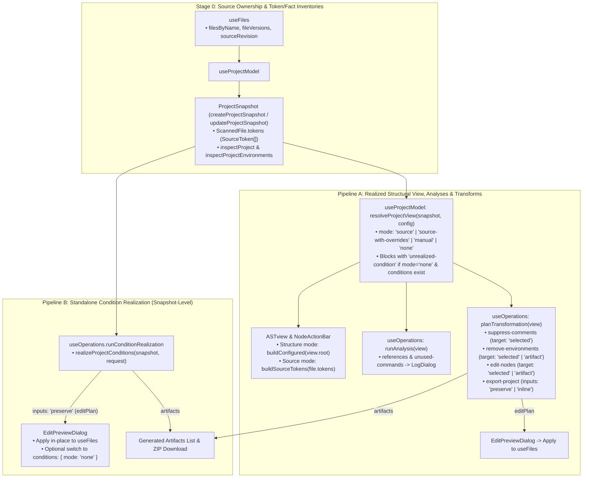

# Website Implementation Plan: Migrating to `@preptex/core@0.4.0` and Two-Pipeline UI

Status: **Proposed Frontend Implementation Specification**
Prepared: 2026-11-16
Target Library: `@preptex/core@0.4.0` (installed in `node_modules/@preptex/core`)

---

## 1. Goal and `@preptex/core@0.4.0` Architectural Contract

`@preptex/core@0.4.0` implements the separated condition-realization and structural-AST architecture specified in [core-condition-pipeline-separation-plan.md](file:///Users/narekbojikian/workspace/preptex/website/docs/plans/core-condition-pipeline-separation-plan.md) and removes all legacy `0.2.x` / `0.3.0` compatibility shims:

1. **Stage 0 — Stateless Whole-File Tokenizer & Source Snapshot (`tokenizeFile`, `createProjectSnapshot`, `updateProjectSnapshot`, `inspectProject`, `inspectProjectEnvironments`)**:
   - Scans each `.tex` file once into lossless primitive tokens (`SourceToken[]` with `SourceTokenKind = 'comment' | 'space' | 'command' | 'open' | 'close' | 'math' | 'text'`) and `SyntaxFact[]` records (**INV-1**, **INV-2**).
   - Never throws on unbalanced LaTeX syntax; per-file issues are recorded in `ScannedFile.coverage.issues` (`readonly ProjectIssue[]`).
2. **Pipeline B — Standalone Condition Realizer (`realizeProjectConditions` / `operation: 'realize-conditions'`)**:
   - Evaluates `\newif`, `\if...`, `\else`, `\fi`, and `[\global]\Xtrue`/`\Xfalse` directly over `file.tokens` (with `traversal: 'project' | 'file-only'`) without constructing a structural AST.
   - Ignores non-condition LaTeX syntax (`{}`, `\begin`/`\end`, math `$`, sections, custom macros), succeeding even when braces/environments are unbalanced or straddle conditional branches (**INV-3**, **INV-5**).
   - Returns `ConditionRealizationResult` containing `status`, `reason`, `decisions`, an in-place `editPlan: ProjectEditPlan | null` (when `inputs === 'preserve'`), and realized condition-free `artifacts: readonly GeneratedArtifact[]`.
3. **Pipeline A — Condition-Free Structural View, Analyses, Node Edits, and Export (`resolveProjectView`, `runAnalysis`, `planTransformation`)**:
   - `resolveProjectView(snapshot, configuration)` runs the shared condition realizer first when `conditions.mode !== 'none'` (`'source' | 'source-with-overrides' | 'manual'`), or passes tokens directly when `conditions.mode === 'none'`.
   - The structural parser builds a condition-free `ConfiguredNode` tree (`'root' | 'section' | 'environment' | 'group' | 'math' | 'token'`) and blocks with `status: 'blocked'` and `reason.code === 'unrealized-condition'` if any unrealized condition command reaches it (**INV-4**).
   - Structural analyses (`references`, `unused-commands`) and transformations (`suppress-comments`, `remove-environments`, `edit-nodes`, `export-project`) operate **exclusively** on a `ready` realized `ProjectView` (**INV-6**).

---

## 2. Summary of Breaking Changes in `@preptex/core@0.4.0`

| Removed `0.2.x` / `0.3.0` Symbol or Option | `@preptex/core@0.4.0` Replacement | Website Impact |
| :--- | :--- | :--- |
| `parseDocument`, `parseProject`, `mergeProjects`, `ParsedProject` | `createProjectSnapshot`, `updateProjectSnapshot`, `resolveProjectView` | Delete legacy `updateProjectSnapshot` in [src/services/core.ts](file:///Users/narekbojikian/workspace/preptex/website/src/services/core.ts) and delete [src/model/useCoreProcess.ts](file:///Users/narekbojikian/workspace/preptex/website/src/model/useCoreProcess.ts). |
| `transformProject`, `InputHandlingMode`, `isInputHandlingMode`, `TransformedFile`, `TransformOptions` | `realizeProjectConditions` (Pipeline B) and `planTransformation(view, { operation: 'export-project', options })` (Pipeline A) | Replace `InputHandlingMode` in [src/model/useControl.ts](file:///Users/narekbojikian/workspace/preptex/website/src/model/useControl.ts) and [src/components/ControlPanel.tsx](file:///Users/narekbojikian/workspace/preptex/website/src/components/ControlPanel.tsx); remove `writeOutputsToTree` in [src/App.tsx](file:///Users/narekbojikian/workspace/preptex/website/src/App.tsx). |
| `AstNode`, `NodeType`, `NodeId`, `SectionLevel`, `ConditionBranchKind`, `isContainerNode`, `ConditionName` | `ConfiguredNode`, `ConfiguredContainerNode`, `isConfiguredContainerNode`, `walkConfiguredNodes`, `SourceToken`, `SourceTokenKind` | Clean up [src/types/LayoutNode.ts](file:///Users/narekbojikian/workspace/preptex/website/src/types/LayoutNode.ts) and [src/components/astview/treebuilder.tsx](file:///Users/narekbojikian/workspace/preptex/website/src/components/astview/treebuilder.tsx). Remove `case 'verbatim'` from `SourceTokenKind` switch. |
| `PrepTexSyntaxError`, `SyntaxDiagnostic`, `WarningDiagnostic`, `DiagnosticCode`, `DiagnosticSeverity` | `ProjectIssue`, `ProjectIssueCode`, `ProjectView.reason`, `ConditionRealizationResult.reason`, `Coverage.issues` | Update `ProcessingError` in [src/services/core.ts](file:///Users/narekbojikian/workspace/preptex/website/src/services/core.ts) and diagnostic rendering in [src/components/LogPanel.tsx](file:///Users/narekbojikian/workspace/preptex/website/src/components/LogPanel.tsx). |
| `PrepTexErrorCode.{SyntaxError, MissingEntry, MissingInput, CircularInput}` | `ProjectIssueCode` (`'structural-error'`, `'missing-entry'`, `'missing-input'`, `'input-cycle'`, `'unrealized-condition'`, etc.) on `view.reason` / `realized.reason` | Surface `view.reason` and `conditionRealization.reason` in `ConfigurationSummary`, `ASTview`, and `LogDialog`. |
| `ConditionPolicy` (`'source' \| 'source-with-overrides' \| 'manual'`) | Added `{ readonly mode: 'none' }` to `ConditionPolicy` | Update [src/components/ProjectSetupDialog.tsx](file:///Users/narekbojikian/workspace/preptex/website/src/components/ProjectSetupDialog.tsx) and [src/components/ConfigurationSummary.tsx](file:///Users/narekbojikian/workspace/preptex/website/src/components/ConfigurationSummary.tsx) to support `mode: 'none'`. |
| `target: 'source'` on `suppress-comments` and `remove-environments` | `suppress-comments` uses `target?: 'selected'` on `ProjectView`; `remove-environments` uses `target: 'selected' \| 'artifact'` on `ProjectView` | Update [src/model/useOperations.ts](file:///Users/narekbojikian/workspace/preptex/website/src/model/useOperations.ts), [src/components/ControlPanel.tsx](file:///Users/narekbojikian/workspace/preptex/website/src/components/ControlPanel.tsx), and [src/App.tsx](file:///Users/narekbojikian/workspace/preptex/website/src/App.tsx). |
| `operation: 'materialize'` and `ExportOptions.conditions: 'preserve' \| 'materialize'` | `realizeProjectConditions` (Pipeline B) or `operation: 'export-project'` with `ExportOptions` (`inputs: 'preserve' \| 'inline'`) on `ProjectView` (Pipeline A) | Add Pipeline B Condition Realization controls and simplify Pipeline A Export Project controls in [src/components/ControlPanel.tsx](file:///Users/narekbojikian/workspace/preptex/website/src/components/ControlPanel.tsx). |

---

## 3. Data-Flow & UI Architecture in the Updated Website



---

## 4. Phase-by-Phase Implementation Plan

### Phase 1: Pure Core Service Layer ([src/services/core.ts](file:///Users/narekbojikian/workspace/preptex/website/src/services/core.ts))

1. **Remove Deleted `0.2.x` / `0.3.0` Imports & Shims**:
   - Remove `mergeProjects`, `parseProject`, `PrepTexSyntaxError`, `ParsedProject`, `SyntaxDiagnostic`, and `TransformOptions` imports.
   - Delete legacy `ProjectSnapshot` wrapper type, `updateProjectSnapshot(previous, sources)`, and `toTransformOptions(options)`.
2. **Add `@preptex/core@0.4.0` Pure Adapters**:
   - `tokenizeFileAdapter(source: string): readonly SourceToken[]` wrapping `tokenizeFile`.
   - `realizeProjectConditionsAdapter(snapshot: CoreProjectSnapshot, request?: ConditionRealizationRequest): ConditionRealizationResult` wrapping `realizeProjectConditions`.
   - `runProjectPipelineAdapter(files: readonly SourceFile[], options: ProjectPipelineOptions): ProjectPipelineResult` wrapping `runProjectPipeline`.
3. **Update `ProcessingError` and `toProcessingError`**:
   - Define `ProcessingError`:
     ```ts
     export type ProcessingError =
       | {
           readonly kind: 'operation';
           readonly message: string;
           readonly code: PrepTexErrorCode;
           readonly failure: OperationFailure;
         }
       | {
           readonly kind: 'core';
           readonly message: string;
           readonly code: PrepTexErrorCode;
         }
       | {
           readonly kind: 'unexpected';
           readonly message: string;
         };
     ```
   - Keep `toProcessingError(error: unknown): ProcessingError` pure, handling `ProjectOperationError`, `PrepTexError`, and unknown errors.

---

### Phase 2: Layout & AST Display Layer ([src/types/LayoutNode.ts](file:///Users/narekbojikian/workspace/preptex/website/src/types/LayoutNode.ts), [src/components/astview/treebuilder.tsx](file:///Users/narekbojikian/workspace/preptex/website/src/components/astview/treebuilder.tsx), [src/components/astview/ASTview.tsx](file:///Users/narekbojikian/workspace/preptex/website/src/components/astview/ASTview.tsx))

1. **Update [src/types/LayoutNode.ts](file:///Users/narekbojikian/workspace/preptex/website/src/types/LayoutNode.ts)**:
   - Remove deleted `@preptex/core` imports (`NodeId`, `NodeType`, `SectionLevel`).
   - Import only `type { NodeLocation, SourceRange } from '@preptex/core'`.
   - Define `export type LayoutSectionLevel = 1 | 2 | 3 | 4 | 5;` (matching `Extract<ConfiguredNode, { kind: 'section' }>['level']`).
   - Update `LAYOUT_NODE_KINDS` to reflect the `0.4.0` condition-free AST and token kinds:
     ```ts
     export const LAYOUT_NODE_KINDS = [
       'root', 'section', 'environment', 'group', 'math',
       'command', 'comment', 'text', 'space', 'token',
     ] as const;
     ```
   - Remove `readonly type: NodeType` from `LayoutNode` (using `readonly kind: LayoutNodeKind` and `readonly id: string`).
2. **Update [src/components/astview/treebuilder.tsx](file:///Users/narekbojikian/workspace/preptex/website/src/components/astview/treebuilder.tsx)**:
   - Import `isConfiguredContainerNode` and `type { ConfiguredNode, SourceToken } from '@preptex/core'`.
   - Remove legacy `build(rootNode: AstNode)`, `convert(node: AstNode)`, `getNodeInfo(node: AstNode)`, and `sectionStrokeWidth`.
   - In `buildConfigured(rootNode: ConfiguredNode)`:
     - Exhaustively map `node.kind` (`'root' | 'environment' | 'section' | 'group' | 'math' | 'token'`).
     - Map `'token'` nodes to more specific `LayoutNodeKind`s when helpful for AST filtering (`'command'` when `token.kind === 'command'`, `'comment'` when `token.kind === 'comment'`, `'text'` when `token.kind === 'text'`, `'space'` when `token.kind === 'space'`, or `'token'`) while preserving `token.name` / `token.value` in `data` and `label` so command filtering in `ASTview` works seamlessly on `ConfiguredNode` trees!
   - In `buildSourceTokens(filePath: string, tokens: readonly SourceToken[])`:
     - Map `SourceTokenKind` (`'comment' | 'space' | 'command' | 'open' | 'close' | 'math' | 'text'`) without `case 'verbatim'`.
3. **Update [src/components/astview/ASTview.tsx](file:///Users/narekbojikian/workspace/preptex/website/src/components/astview/ASTview.tsx)**:
   - Bump `STORAGE_KEY` to `'preptex.astview.options.v6'` (and keep safe validation of `localStorage`).
   - Add optional `viewIssue?: ProjectIssue | null` prop so when `structureMode === 'configured'` and `root === null` because the view is `incomplete` or `blocked` (e.g., `unrealized-condition`, `unknown-condition`, `structural-error`), `ASTview` displays the specific `viewIssue.code` and `viewIssue.message` instead of a generic empty message.

---

### Phase 3: State & Model Hooks ([src/model/useControl.ts](file:///Users/narekbojikian/workspace/preptex/website/src/model/useControl.ts), [src/model/useProjectModel.ts](file:///Users/narekbojikian/workspace/preptex/website/src/model/useProjectModel.ts), [src/model/useOperations.ts](file:///Users/narekbojikian/workspace/preptex/website/src/model/useOperations.ts))

1. **Update [src/model/useControl.ts](file:///Users/narekbojikian/workspace/preptex/website/src/model/useControl.ts)**:
   - Remove `InputHandlingMode` and `ConditionName` imports.
   - Define `InputHandlingOption = 'preserve' | 'inline'` and guard `isInputHandlingOption(value: string): value is InputHandlingOption`.
   - Update `CoreOptionsUI`:
     ```ts
     export interface CoreOptionsUI {
       readonly suppressComments: boolean;
       readonly suppressCommentEnvironments: boolean;
       readonly inputHandling: InputHandlingOption;
       readonly stripDeclarationsAndSetters: boolean;
       readonly outputName: string;
     }
     ```
2. **Delete [src/model/useCoreProcess.ts](file:///Users/narekbojikian/workspace/preptex/website/src/model/useCoreProcess.ts)**:
   - Remove the obsolete hook that depended on `parseProject`, `mergeProjects`, and `transformProject`.
3. **Update [src/model/useProjectModel.ts](file:///Users/narekbojikian/workspace/preptex/website/src/model/useProjectModel.ts)**:
   - Accept `fileVersions?: Readonly<Record<ProjectFilePath, number>>` and use `updateProjectSnapshotAdapter` incrementally when updating existing snapshots, falling back to `createProjectSnapshotAdapter` on initial creation or error recovery.
   - Filter `condition-test` facts in `detectedConditions` by `fact.testKind === 'named-candidate'` so primitive TeX conditionals (`\ifmmode`, `\ifx`, `\ifnum`, `\ifdim`) and literal `\iftrue`/`\iffalse` are not offered as boolean flag overrides.
   - Expose `issues: readonly ProjectIssue[]` combining `view?.reason` (when `view.status !== 'ready'`), `view?.coverage.issues`, and per-file `snapshot.files.flatMap((f) => f.coverage.issues)`.
4. **Update [src/model/useOperations.ts](file:///Users/narekbojikian/workspace/preptex/website/src/model/useOperations.ts)**:
   - Add **Pipeline B (`realize-conditions`)** state and actions:
     - `conditionRealization: ConditionRealizationResult | null`
     - `checkConditionRealizationCapability(options: ConditionRealizationRequest): OperationCapability` (checks against `snapshot`).
     - `realizeConditions(options: ConditionRealizationRequest, mode: 'preview-edits' | 'export-artifacts'): ConditionRealizationResult | null`:
       - Calls `realizeProjectConditionsAdapter(snapshot, options)`.
       - Stores `conditionRealization: result`.
       - When `result.status === 'ready'`:
         - If `mode === 'preview-edits'` and `result.editPlan !== null`, sets `pendingEditPlan: result.editPlan`, `editPlanSnapshotId: snapshot.id`, `editPlanViewId: null`.
         - If `mode === 'export-artifacts'`, sets `artifacts: result.artifacts`.
   - Update **Pipeline A** transformation routing:
     - `checkTransformationCapability(request)` and `planTransformation(request)`:
       - Use `snapshot` when `request.operation === 'realize-conditions'`.
       - Use `view` when `request.operation` is `'suppress-comments' | 'remove-environments' | 'edit-nodes' | 'export-project'`.
   - Update `applyPendingEdits` and `isEditPlanStale`:
     - Distinguish snapshot-level edit plans (`pendingEditPlan.provenance.viewId === null`, from Pipeline B `realize-conditions`) from view-level edit plans (`pendingEditPlan.provenance.viewId !== null`, from Pipeline A):
       - Snapshot-level plans validate and apply via `validateProjectEditPlanAdapter(snapshot, plan)` and `applyProjectEditsAdapter(snapshot, plan)` without requiring a ready `view`.
       - View-level plans validate and apply via `validateProjectEditPlanAdapter(snapshot, plan, view ?? undefined)` and `applyProjectEditsAdapter(snapshot, plan, view ?? undefined)`.

---

### Phase 4: UI Component Updates

1. **Project Settings & Summary ([src/components/ProjectSetupDialog.tsx](file:///Users/narekbojikian/workspace/preptex/website/src/components/ProjectSetupDialog.tsx) & [src/components/ConfigurationSummary.tsx](file:///Users/narekbojikian/workspace/preptex/website/src/components/ConfigurationSummary.tsx))**:
   - In `ProjectSetupDialog.tsx`:
     - Update `policyMode` state type to `ConditionPolicy['mode']` (`'source' | 'source-with-overrides' | 'manual' | 'none'`).
     - Add `<option value="none">None — assert source is condition-free (INV-4)</option>` to `#condition-mode-select`.
     - In `handleApply`, when `policyMode === 'none'`, commit `conditionPolicy = { mode: 'none' }`.
     - Only show the "Recognized Conditions" per-flag table when `detectedConditions.length > 0 && (policyMode === 'source-with-overrides' || policyMode === 'manual')`.
   - In `ConfigurationSummary.tsx`:
     - Handle `conditionPolicy.mode === 'none'` (`'Condition-free (none)'`).
     - When `view.status === 'incomplete' || view.status === 'blocked'`, include `view.reason.code` in the status badge or title (e.g., `Blocked: unrealized-condition`, `Incomplete: unknown-condition`, `Blocked: structural-error`).

2. **Operations Dialog & Control Panel ([src/components/ControlPanel.tsx](file:///Users/narekbojikian/workspace/preptex/website/src/components/ControlPanel.tsx) & [src/components/OperationsDialog.tsx](file:///Users/narekbojikian/workspace/preptex/website/src/components/OperationsDialog.tsx))**:
   - Organize `ControlPanel` into clear cards aligned with `@preptex/core@0.4.0`:
     - **Card 1 — Pipeline B: Condition Realization (Standalone)**:
       - Operates directly on the source snapshot (`canRealizeConditions = Boolean(snapshot)`), even if the structural AST is blocked by unbalanced braces or straddling environments (**INV-3**).
       - Options:
         - `Strip \newif declarations and \Xtrue/\Xfalse setters` (`options.stripDeclarationsAndSetters`, default `true`).
         - `Realization inputs`: `'preserve'` (per-file in-place edits / artifacts) vs `'inline'` (single inlined artifact).
       - Buttons:
         - **Realize Conditions in Place (Preview Edits)**: calls `onRealizeConditions('preview-edits')` (`inputs: 'preserve'`), opening `EditPreviewDialog` with the condition-stripping `ProjectEditPlan`.
         - **Export Realized Files**: calls `onRealizeConditions('export-artifacts')`, adding condition-free `GeneratedArtifact[]` files.
       - Shows a compact list of `ConditionDecision` outcomes (`\ifdraft -> true`, etc.) when decisions are available from the current view or latest realization.
     - **Card 2 — Pipeline A: Structural Analyses (Realized View)**:
       - `Check References` (`references`) and `Check Commands` (`unused-commands`), enabled when `canRunReferences` / `canRunCommandUsage` are true.
     - **Card 3 — Pipeline A: Structural Transformations (Realized View)**:
       - **Comment Suppression (`suppress-comments`)**:
         - Always targets the realized `ProjectView` (`target: 'selected'`).
         - Checkbox: `Suppress comment environments (\begin{comment})`.
         - Button: `Preview Comments` (disabled when view is not ready).
       - **Remove Environments by Name (`remove-environments`)**:
         - Input for comma-separated environment names (`e.g. comment, C`).
         - Target selector: `'selected'` (`Checked source edits`) vs `'artifact'` (`Inlined artifact`).
         - Button: `Preview Removal` (disabled when view is not ready or names are empty).
     - **Card 4 — Pipeline A: Export Realized Project (`export-project`)**:
       - Entry file (read-only) and optional Output file name (`options.outputName`).
       - `Input handling` (`#handleInputCmd`): `'preserve'` vs `'inline'`.
       - `Suppress comments` checkbox (`options.suppressComments`) and `Suppress comment environments` checkbox (`options.suppressCommentEnvironments`).
       - Primary `Export Project` / `Run` button: runs `export-project` on the realized `ProjectView` and populates Generated Artifacts (applying custom `options.outputName` when exporting a single entry artifact).
     - **Card 5 — Generated Artifacts**:
       - Lists generated artifacts with `topology` badge, `View`, `Download`, and `Download ZIP`.

3. **Log Panel & Dialog ([src/components/LogPanel.tsx](file:///Users/narekbojikian/workspace/preptex/website/src/components/LogPanel.tsx) & [src/components/LogDialog.tsx](file:///Users/narekbojikian/workspace/preptex/website/src/components/LogDialog.tsx))**:
   - Replace `WarningDiagnostic` with `ProjectIssue` (`from '@preptex/core'`).
   - Display:
     - `viewIssue?: ProjectIssue | null` (when `view` or `conditionRealization` is `incomplete` or `blocked`) as an alert banner/entry with clickable location jump link.
     - `error: ProcessingError | null` (from `ProjectOperationError` or `PrepTexError`).
     - `findings: readonly AnalysisFinding[]` (`references`, `unused-commands`) with clickable primarylocation jump links.
     - `diagnostics: readonly ProjectIssue[]` (coverage issues from `view` or `snapshot`) with severity, code, message, and clickable location jump links.

4. **Main Application Composition ([src/App.tsx](file:///Users/narekbojikian/workspace/preptex/website/src/App.tsx))**:
   - Remove `useCoreProcess` and `TransformedFile`.
   - Connect `projectModel.issues` and `projectModel.view?.reason` to `LogDialog`, `ConfigurationSummary`, and `ASTview`.
   - Connect Pipeline B (`realizeConditions`) and Pipeline A (`planTransformation`, `runReferences`, `runCommandUsage`) to `OperationsDialog` and `EditPreviewDialog`.

---

### Phase 5: Test Suite Migration & New Acceptance Tests

Update all affected test suites to test against the real `@preptex/core@0.4.0` package without mocking:

| Test File | Updates & New `0.4.0` Acceptance Cases |
| :--- | :--- |
| [src/services/coreAdapters.test.ts](file:///Users/narekbojikian/workspace/preptex/website/src/services/coreAdapters.test.ts) | Remove `PrepTexSyntaxError` / `DiagnosticCode` / `PrepTexErrorCode.MissingEntry`. Add tests for `tokenizeFileAdapter` (`V-TOK-1`), `realizeProjectConditionsAdapter` ignoring unbalanced braces/environments (`V-COND-1`, `V-COND-2`), `resolveProjectViewAdapter` blocking with `'unrealized-condition'` when `conditions: { mode: 'none' }` (`V-AST-1`), and two-pipeline composition (`V-PIPE-1`). |
| [src/services/core.test.ts](file:///Users/narekbojikian/workspace/preptex/website/src/services/core.test.ts) | Replace legacy `0.2.x` `updateProjectSnapshot` / `transformProject` tests with `0.4.0` snapshot incremental updates, line-ending preservation, condition realization policies (`source`, `source-with-overrides`, `manual`, `none`), and `toProcessingError` coverage. |
| [src/services/transformations.test.ts](file:///Users/narekbojikian/workspace/preptex/website/src/services/transformations.test.ts) | Update `suppress-comments` and `remove-environments` to run on `ProjectView` with `target: 'selected'` and `'artifact'` (**INV-6**); add standalone `realize-conditions` edit-plan & apply test; replace `operation: 'materialize'` with `operation: 'export-project'`. |
| [src/components/astview/treebuilder.test.ts](file:///Users/narekbojikian/workspace/preptex/website/src/components/astview/treebuilder.test.ts) | Replace `parseDocument` with `createProjectSnapshot` + `resolveProjectView` (`buildConfigured`) and `buildSourceTokens`, verifying starred sections, math delimiters, environments, and command tokens. |
| [src/components/ControlPanel.test.tsx](file:///Users/narekbojikian/workspace/preptex/website/src/components/ControlPanel.test.tsx) | Update for `0.4.0` `CoreOptionsUI`, Pipeline B condition realization buttons, Pipeline A comment/environment previews (`target: 'selected'`), and `export-project` artifact provenance. |
| [src/components/EditPreviewDialog.test.tsx](file:///Users/narekbojikian/workspace/preptex/website/src/components/EditPreviewDialog.test.tsx) | Update mock `ProjectEditPlan` provenance to `target: 'selected'` (and test `realize-conditions` provenance). |
| [src/components/ProjectSetupDialog.test.tsx](file:///Users/narekbojikian/workspace/preptex/website/src/components/ProjectSetupDialog.test.tsx) | Add test for selecting and applying `conditions: { mode: 'none' }` and rendering `ConfigurationSummary` with `Condition-free (none)` and `Blocked` / `Incomplete` badges. |
| [src/model/operations.test.tsx](file:///Users/narekbojikian/workspace/preptex/website/src/model/operations.test.tsx) | Update `suppress-comments` to `target: 'selected'`; add test for `realizeConditions` producing an in-place `editPlan` on a snapshot even when the structural view is blocked by unbalanced environments (**INV-3**). |
| [src/model/project.test.tsx](file:///Users/narekbojikian/workspace/preptex/website/src/model/project.test.tsx) | Migrate from `useCoreProcess` to `useFiles` + `useProjectConfiguration` + `useProjectModel` + `useOperations`, testing StrictMode batching, missing-input recovery, and view readiness. |
| [src/App.test.tsx](file:///Users/narekbojikian/workspace/preptex/website/src/App.test.tsx) | Update end-to-end UI tests for `0.4.0`: structural error reporting in `LogDialog`, standalone condition realization preview & apply, comment suppression preview & apply, environment removal preview, and project export/artifact viewing. |

---

### Phase 6: Documentation & Verification Gate

1. Update [docs/architecture.md](file:///Users/narekbojikian/workspace/preptex/website/docs/architecture.md) and [AGENTS.md](file:///Users/narekbojikian/workspace/preptex/website/AGENTS.md) to reflect `@preptex/core@0.4.0`, the removal of `useCoreProcess`, and the two-pipeline architecture (`Pipeline B: realizeProjectConditions` and `Pipeline A: resolveProjectView / runAnalysis / planTransformation`).
2. Run all required verification checks:
   ```sh
   npm run typecheck
   npm run lint
   npm run test:ci
   npm run build
   ```
