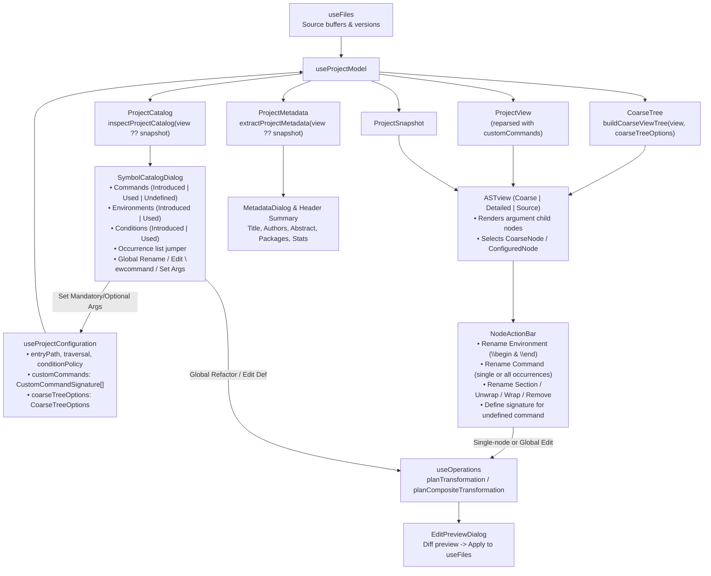

# Website Implementation Plan: Coarse View Tree, Node & Symbol Refactoring, Dynamic Command Signatures, and Document Metadata

Status: **Proposed Frontend Implementation Specification**
Prepared: 2026-11-16
Target Library: `@preptex/core@0.5.0` (specified in [core-phase2-catalog-coarse-tree-plan.md](file:///Users/narekbojikian/workspace/preptex/website/docs/plans/core-phase2-catalog-coarse-tree-plan.md))

---

## 1. Goal and Core-First Integration Principle

All structural coarsening, argument child-node construction, symbol cataloging, occurrence tracking, dynamic command-signature reparsing, single-node and bulk refactorings, and metadata extraction are implemented inside `@preptex/core@0.5.0`. The website remains a thin, reactive presentation and state-coordination layer that displays core models and dispatches core operations:

1. **Coarse View Tree by Default (`buildCoarseViewTree`)**:
   - The AST pane defaults to **Coarse** mode (alongside **Detailed AST** and **Source Tokens**), rendering the readable `CoarseTree` from `@preptex/core` where main document structures (`section`, `environment`, `command` $\rightarrow$ `argument` child nodes, and display `math`) are prominent and token noise (`space`, delimiter braces, prose runs) is eliminated.
   - Command and environment arguments appear as explicit `argument` child nodes (`[#1]`, `{#1}: ...`) under their parent command/environment node.
2. **Editable Nodes (`NodeActionBar` & Inline Name Editing)**:
   - Selecting an `environment`, `command`, or `section` node in the tree enables editing its name or structure:
     - **Environment**: Editing `enumerate` $\rightarrow$ `itemize` dispatches `rename-environment`, replacing both `\begin{enumerate}` and `\end{enumerate}` (even when optional arguments follow `\begin`).
     - **Command**: Editing `\textbf` $\rightarrow$ `\textit` or `\mycmd` $\rightarrow$ `\newcmd` dispatches `rename-command`, replacing the command while keeping its `*` and `argument` children intact.
     - **Section**: Changing level (`section` $\leftrightarrow$ `subsection`) or toggling `*` dispatches `rename-section`.
     - **Unwrap / Wrap / Remove**: Unwrapping a formatting command or environment (`unwrap-node`), wrapping (`wrap-node`), or removing (`remove-node`).
3. **Introduced & Used Symbol Catalog (`CatalogDialog` / `CatalogPanel`)**:
   - Displays interactive lists of **Introduced (Defined/Declared)** and **Used** **Commands**, **Environments**, **Conditions**, **Labels & References**, and **Citations** from `inspectProjectCatalog(view ?? snapshot)`.
   - Expanding any entry shows its **implicit list of all occurrences** (definitions/declarations + uses) with one-click navigation to `Codeview`.
   - **Modify All Occurrences & Definitions**:
     - Rename any command from the list (`rename-command-globally`), updating all uses and its `\newcommand` / `\def` definition via `EditPreviewDialog`.
     - Edit a `\newcommand` definition (`edit-command-definition`: name, `[numArgs]`, `[default]`, `{body}`).
     - Rename any environment globally (`rename-environment-globally`), updating all `\begin`/`\end` pairs and `\newenvironment`/`\newtheorem` definitions.
     - Rename any condition flag globally (`rename-condition-globally`), updating `\newif\ifX`, `\ifX`, `\Xtrue`, and `\Xfalse`.
     - Rename any label key globally (`rename-label-globally`), updating `\label{key}` and all `\ref`/`\eqref`/`\pageref`/`\autoref`/`\cref`/`\Cref` occurrences.
     - Rename any citation key globally (`rename-citation-globally`), updating `\bibitem{key}` and all `\cite`/`\citep`/`\citet` occurrences (even inside `{k1, k2}` lists).
4. **Used Undefined Commands — Argument Count Specification & Live Reparsing**:
   - In the **Used Undefined Commands** section of the Catalog (and in `NodeActionBar` when an undefined command token is selected), users can specify the number of **optional arguments (`0–9`)** and **mandatory arguments (`0–9`)**.
   - Updating an undefined command's signature updates `customCommands` in `useProjectConfiguration`, which passes `customCommands` into `resolveProjectView` so `@preptex/core` immediately **reparses** the document and displays the command with its `argument` child nodes in the tree!
5. **Document Metadata Inspector & Editor (`MetadataDialog` / `MetadataCard`)**:
   - Displays structured metadata from `extractProjectMetadata(view ?? snapshot)`: **Title**, **Authors** (with affiliations/notes), **Date**, **Abstract**, **Document Class**, **Packages**, **Bibliography**, and **Project Statistics**, with click-to-jump links to source locations.
   - Allows **direct editing** of **Title** (and optional short title), **Authors**, **Date**, and **Abstract** right from the Metadata dialog, dispatching `{ kind: 'edit-metadata', field, newValue, shortValue }` through `planTransformation` $\rightarrow$ `EditPreviewDialog` so changes are previewed and applied safely via `ProjectEditPlan`.
6. **Composable Multi-Step Transformation Pipeline (`planCompositeTransformation` in `OperationsDialog` & `useOperations`)**:
   - Allows users to queue or chain multiple transformation steps (e.g., `realize-conditions` $\rightarrow$ `refactor-symbols` $\rightarrow$ `edit-nodes` $\rightarrow$ `suppress-comments` $\rightarrow$ `remove-environments` $\rightarrow$ `export-project`) and preview/apply them as a single unified `ProjectEditPlan` in `EditPreviewDialog` or export the final artifacts in one step.

---

## 2. Website Data Flow & Component Architecture



---

## 3. Phase-by-Phase Website Implementation Plan

### Phase W1: Pure Core Service Adapters ([src/services/core.ts](file:///Users/narekbojikian/workspace/preptex/website/src/services/core.ts))

Add pure adapters for the new `@preptex/core@0.5.0` entry points:
- `buildCoarseViewTreeAdapter(view: ProjectView, options?: CoarseTreeOptions): CoarseTree`
- `inspectProjectCatalogAdapter(model: CoreProjectSnapshot | ProjectView, options?: { scope?: SourceScope; customCommands?: readonly CustomCommandSignature[] }): ProjectCatalog`
- `extractProjectMetadataAdapter(model: CoreProjectSnapshot | ProjectView): ProjectMetadata`
- `planCompositeTransformationAdapter(snapshot: CoreProjectSnapshot, steps: readonly TransformationRequest[], viewConfig?: ViewConfiguration): TransformationResult`

---

### Phase W2: Configuration, Model & Operations Hooks ([src/model/useProjectConfiguration.ts](file:///Users/narekbojikian/workspace/preptex/website/src/model/useProjectConfiguration.ts), [src/model/useProjectModel.ts](file:///Users/narekbojikian/workspace/preptex/website/src/model/useProjectModel.ts), [src/model/useOperations.ts](file:///Users/narekbojikian/workspace/preptex/website/src/model/useOperations.ts))

1. **Extend `useProjectConfiguration.ts`**:
   - Add `customCommands: readonly CustomCommandSignature[]` to `ProjectConfigurationState`.
   - Add actions:
     - `upsertCustomCommand(sig: CustomCommandSignature): void` (sets or updates `[optionalArgs, mandatoryArgs, allowStar, opaque]` for a command name and increments configuration `revision` so `resolveProjectView` reparses immediately).
     - `removeCustomCommand(name: string): void`
2. **Extend `useProjectModel.ts`**:
   - Pass `customCommands: config.customCommands` into `resolveProjectViewAdapter(snapshot, { entryPath, traversal, conditions, customCommands })`.
   - Derive and memoize:
     - `coarseTree: CoarseTree | null` via `buildCoarseViewTreeAdapter(view, coarseOptions)` when `view?.status === 'ready'`.
     - `catalog: ProjectCatalog | null` via `inspectProjectCatalogAdapter(view?.status === 'ready' ? view : snapshot, { customCommands: config.customCommands })`.
     - `metadata: ProjectMetadata | null` via `extractProjectMetadataAdapter(view?.status === 'ready' ? view : snapshot)`.
3. **Extend `useOperations.ts`**:
   - Support `'refactor-symbols'` (`SymbolRefactorRequest`) in `checkTransformationCapability` and `planTransformation` so global command/environment/condition/label/citation renames, `\newcommand` definition edits, and metadata edits stage a `ProjectEditPlan` in `EditPreviewDialog` just like node edits.
   - Add `planCompositeTransformation(steps: readonly TransformationRequest[])` using `planCompositeTransformationAdapter` so users can compose and preview a multi-step transformation pipeline as a single unified `ProjectEditPlan` or final `GeneratedArtifact[]`.

---

### Phase W3: Coarse Tree View & Argument Child Nodes ([src/types/LayoutNode.ts](file:///Users/narekbojikian/workspace/preptex/website/src/types/LayoutNode.ts), [src/components/astview/treebuilder.tsx](file:///Users/narekbojikian/workspace/preptex/website/src/components/astview/treebuilder.tsx), [src/components/astview/ASTview.tsx](file:///Users/narekbojikian/workspace/preptex/website/src/components/astview/ASTview.tsx))

1. **Update `LayoutNode.ts`**:
   - Add `'argument'` and `'text-block'` to `LAYOUT_NODE_KINDS`:
     ```ts
     export const LAYOUT_NODE_KINDS = [
       'root',
       'section',
       'environment',
       'command',
       'argument',
       'math',
       'group',
       'text-block',
       'comment',
       'text',
       'space',
       'token',
     ] as const;
     ```
   - Add optional `editableName?: boolean`, `argumentInfo?: CoarseNode['argumentInfo']`, and `previewText?: string` to `LayoutNode`.
2. **Update `TreeLayoutBuilder` (`treebuilder.tsx`)**:
   - Add `buildCoarse(coarseTree: CoarseTree): LayoutNode` which directly maps `CoarseNode` into `LayoutNode`:
     - `section`: icon `'S'`, label `node.name`, sublabel `section` / `subsection`
     - `environment`: icon `'E'`, label `node.name`, sublabel `'environment'`
     - `command`: icon `'\\'`, label `\` + `node.name` + (`node.starred ? '*' : ''`), sublabel `'command'`, children = its `argument` nodes!
     - `argument`: icon `'[]'` (when `argKind === 'optional'`) or `'{}'` (when `argKind === 'mandatory'`), label `node.previewText ? `${node.name} ${node.previewText}` : node.name`, sublabel `node.argumentInfo.argKind`
   - Update `buildConfigured(rootNode: ConfiguredNode)` to handle `case 'argument':` exhaustively.
3. **Update `ASTview.tsx`**:
   - Support 3 structure modes in the mode toggle:
     - **Coarse** (`'coarse'`, default): renders `buildCoarse(coarseTree)`—clean, readable hierarchy of sections, environments, commands, and their argument children.
     - **Detailed** (`'configured'`): renders `buildConfigured(view.root)`—full lossless AST.
     - **Source** (`'source'`): renders `buildSourceTokens(file.tokens)`.

---

### Phase W4: Enhanced Node Editing (`NodeActionBar.tsx`)

Upgrade [src/components/NodeActionBar.tsx](file:///Users/narekbojikian/workspace/preptex/website/src/components/NodeActionBar.tsx) so selecting any node in the tree offers context-aware editing:
1. **When an `environment` node is selected**:
   - Input pre-filled or placeholder with current environment name (`e.g. enumerate` $\rightarrow$ `itemize`).
   - **Rename Environment (This Occurrence)** button $\rightarrow$ dispatches `edit-nodes` with `{ kind: 'rename-environment', selection, name }`.
   - **Rename All `<env>` Occurrences** button $\rightarrow$ dispatches `refactor-symbols` with `{ kind: 'rename-environment-globally', oldName, newName }`.
   - **Unwrap Environment** button $\rightarrow$ dispatches `{ kind: 'unwrap-node', selection }`.
2. **When a `command` node (or command token) is selected**:
   - Input to edit command name (`\old` $\rightarrow$ `\new`).
   - **Rename This Command** button $\rightarrow$ dispatches `edit-nodes` with `{ kind: 'rename-command', selection, name }` (keeps arguments intact).
   - **Rename All `\<cmd>` Occurrences** button $\rightarrow$ dispatches `refactor-symbols` with `{ kind: 'rename-command-globally', oldName, newName }`.
   - If the command is an **undefined command** (or custom command), inline quick-controls to set **Optional Args (`0–9`)** and **Mandatory Args (`0–9`)** & **Reparse**.
3. **When a `section` node is selected**:
   - Dropdown to change section level (`section`, `subsection`, `subsubsection`, `paragraph`, `subparagraph`) and checkbox for `*` (`rename-section`).
4. **Always available on eligible nodes**:
   - **Wrap in Environment** (`wrap-node`) and **Remove Node** (`remove-node`).

---

### Phase W5: Symbol & Construct Catalog Dialog/Panel (`src/components/CatalogDialog.tsx`)

Create `CatalogDialog.tsx` (accessible from the top bar next to Operations & Settings):
1. **Five Main Tabs**: **Commands**, **Environments**, **Conditions**, **Labels & References**, **Citations**.
2. **Filter Sub-tabs**:
   - **All** | **Introduced (Defined/Declared)** (`\newcommand`, `\def`, `\newenvironment`, `\newtheorem`, `\newif`, `\label`, `\bibitem`) | **Used in Document** | **Used Undefined / Unresolved** (commands, environments, or labels used without a definition/declaration).
3. **Per-Item Capabilities**:
   - **Occurrence Count Badge & Expandable Occurrence Drawer**:
     - Shows `N uses` and `M definitions/declarations`. Clicking expands the list of all occurrences (`file.tex:Line X`), each clickable to jump `Codeview` to that exact range.
   - **Rename All Occurrences**:
     - Inline rename input on any command, environment, condition, label key, or citation key entry $\rightarrow$ previews global rename (all uses + definition/declaration) in `EditPreviewDialog` (`rename-command-globally`, `rename-environment-globally`, `rename-condition-globally`, `rename-label-globally`, `rename-citation-globally`).
   - **Edit Definition (for Introduced Commands)**:
     - For `\newcommand` entries, displays the current signature `[numArgs][default]` and `{body}` with an **Edit Definition** form (`newName`, `numArgs`, `defaultArg`, `newBody`) dispatching `edit-command-definition`.
   - **Specify Arguments & Reparse (for Used Undefined Commands)**:
     - For every command in **Used Undefined Commands**, displays numeric steppers/inputs for **Optional Args (`0–9`)** and **Mandatory Args (`0–9`)** with a **Reparse** button.
     - Clicking **Reparse** updates `customCommands` in `useProjectConfiguration`, immediately reparsing the `ProjectView` and `CoarseTree` so the command's arguments become child nodes in the AST!

---

### Phase W6: Document Metadata Inspector & Editor (`src/components/MetadataDialog.tsx` & `ConfigurationSummary.tsx`)

1. Surface the extracted document title and quick stats in `ConfigurationSummary` (or a **Metadata** button in the top bar).
2. Create `MetadataDialog.tsx` displaying `ProjectMetadata`:
   - **Editable Core Metadata Fields**:
     - **Title** (and optional `[short]` title), **Authors** (`\author{...}`), **Date** (`\date{...}`), and **Abstract** (`\begin{abstract}...\end{abstract}`) each provide an inline **Edit** action that dispatches `{ kind: 'edit-metadata', field, newValue, shortValue }` via `useOperations.planTransformation` $\rightarrow$ `EditPreviewDialog`.
   - **Preamble & Bibliography**: `\documentclass` + options, loaded `\usepackage` list + options, `\bibliography` / `\addbibresource` files.
   - **Document Counts**: Sections, Environments, Figures, Tables, Math blocks, Defined vs. Undefined Commands, Labels, References, Citations.
   - Every metadata item has a **Jump to Source** button that navigates `Codeview` to its exact `location`.

---

### Phase W7: Composable Multi-Step Transformation Pipeline UI (`src/components/ControlPanel.tsx` & `OperationsDialog.tsx`)

1. Add a **Composable Pipeline Builder** card in `ControlPanel.tsx`:
   - Users can toggle/order a multi-step sequence of operations to run together:
     1. `Realize Conditions` (`realize-conditions`)
     2. `Queued Symbol / Node Refactorings` (`refactor-symbols` & `edit-nodes`)
     3. `Suppress Comments` (`suppress-comments`)
     4. `Remove Environments` (`remove-environments`)
     5. `Optional Final Export` (`export-project`)
   - Clicking **Preview Composed Pipeline Edits** calls `useOperations.planCompositeTransformation(steps)`, opening `EditPreviewDialog` with the single combined `ProjectEditPlan` against the current source files (or generating the final `GeneratedArtifact[]`).

---

## 4. Verification & Test Suite Updates

1. Add unit and integration tests:
   - `src/components/astview/treebuilder.test.ts`: Tests `buildCoarse` rendering of sections, environments, commands, and `argument` child nodes (`[#1]`, `{#1}`).
   - `src/components/NodeActionBar.test.tsx`: Tests renaming a selected command, renaming a selected environment, changing section level, and unwrapping.
   - `src/components/CatalogDialog.test.tsx`: Tests viewing introduced vs. used commands/environments/conditions, jumping to occurrences, triggering global command/environment/condition rename, editing a `\newcommand` definition, and setting optional/mandatory argument counts on a used undefined command to trigger reparsing.
   - `src/components/MetadataDialog.test.tsx`: Tests rendering extracted title, authors, abstract, packages, and stats.
2. Run all required checks:
   ```sh
   npm run typecheck
   npm run lint
   npm run test:ci
   npm run build
   ```
