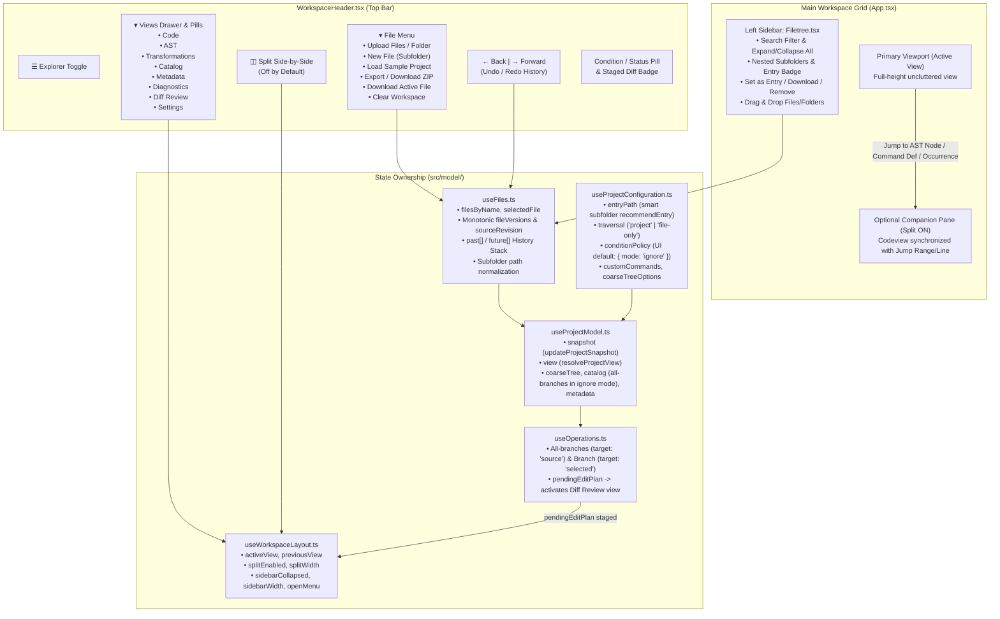

# Website Implementation Plan: Modern Workspace UI Redesign, Top-Bar Menus (`File` & `Views`), Advanced Subfolder Explorer, Lazy Phase 0, Side-by-Side Split View, and Transformation Undo/Redo History

Status: **Proposed Frontend Implementation Specification**
Prepared: 2026-11-17
Target Library: `@preptex/core` (specified in [core-phase3-ignore-conditions-subfolders-plan.md](file:///Users/narekbojikian/workspace/preptex/website/docs/plans/core-phase3-ignore-conditions-subfolders-plan.md))
Development Guide: [website/AGENTS.md](file:///Users/narekbojikian/workspace/preptex/website/AGENTS.md)

---

## 1. Goal and UX Architecture

This specification redesigns the PrepTeX browser application (`website/`) from a fixed 3-column layout with 6 modal popups into a clean, modern, single-viewport workspace with an advanced **File Explorer** on the left, a **Top Bar** housing **`File`** and **`Views`** menus plus **Undo/Redo (`←`/`→`)** history and an optional **Split Side-by-Side** toggle, **Lazy Phase 0** condition configuration, and an inline **Diff Review** workflow:

1. **Dedicated Left Sidebar: Advanced File Explorer (`Filetree.tsx`)**:
   - Only the **File Explorer** lives in the left collapsible/resizable sidebar (views are never mixed into the left sidebar).
   - Supports nested subfolders with expand/collapse-all, real-time file/folder search filtering, file-type badges (`TEX`, `BIB`, `STY`), an `Entry` badge with one-click **Set as Entry**, a **New File / Subfolder Path** creator (e.g. `intro/history.tex`), drag-and-drop file/folder upload, and smart folder wrapper normalization (`useFiles.ts`).
2. **Top Bar (`WorkspaceHeader.tsx`) with `File` Menu & Expandable `Views` Drawer**:
   - **`File` Menu Button**: Opens a dropdown menu for `Upload Files...`, `Upload Folder...`, `New File...`, `Load Sample Project`, `Export Project`, `Download ZIP`, `Download Active File`, and `Clear Workspace`.
   - **`Views` Menu Button (Expandable Drawer) & Quick View Switcher**: Expands a structured list of all workspace views (`Code`, `AST`, `Transformations`, `Catalog`, `Metadata`, `Diagnostics`, `Diff Review`, `Settings`) with icons, descriptions, and live status/count badges, alongside compact top-bar view pills.
   - **Undo / Redo History Arrows (`←` Back / `→` Forward)**: Step backward and forward through applied file transformations while keeping `fileVersions` strictly monotonic for `@preptex/core`.
   - **Optional Split Side-by-Side Toggle (`◫ Split View`)**: Off by default. When enabled, opens `Codeview` in a resizable companion pane beside the active view (`AST`, `Catalog`, `Metadata`, `Diagnostics`, `Transformations`) so clicking an AST node, command definition, or occurrence jumps immediately in the adjacent code editor.
3. **Zero Upfront Popups & Lazy Phase 0 Condition Setup**:
   - Importing files into an empty workspace auto-selects the recommended entry (`main.tex` or `\documentclass` file) and defaults to `conditionPolicy: { mode: 'ignore' }` (all branches visited). Neither `ProjectSetupDialog` nor `LogDialog` pops up automatically.
   - Whole-document transformations (**Global Symbol Refactoring**, **Definition Editing**, **Metadata Editing**, **Comment Suppression**, **Environment Removal**, **Project Export**) default to **All Branches (`target: 'source'`)** and run without Phase 0.
   - **Phase 0 condition configuration** is requested inline **only** when needed: inside **AST View** (when conditionals exist or cause cross-branch structural mismatch) and inside **Transformations** (when running Pipeline B Condition Realization or selecting `Configured Branch Only`).
4. **Inline `Diff Review` View + In-Place File Override with History**:
   - Every source-modifying operation stages its `ProjectEditPlan` and switches to the **`Diff Review`** view (no modal popup).
   - Clicking **Apply Changes** overwrites the current project files in-place, records a snapshot on the `useFiles` undo stack (enabling the `←` Back and `→` Forward arrows), and returns to `Code` (or the originating view).

---

## 2. Frontend Component & State Data-Flow Diagram



---

## 3. Step-by-Step Frontend Implementation Specification

### Step F1: Core Service Adapters ([src/services/core.ts](file:///Users/narekbojikian/workspace/preptex/website/src/services/core.ts))
- Ensure `src/services/core.ts` imports only from `@preptex/core` ([website/AGENTS.md](file:///Users/narekbojikian/workspace/preptex/website/AGENTS.md)).
- Expose type-safe adapters for:
  - `resolveProjectViewAdapter` with `ConditionPolicy` including `{ mode: 'ignore' }`.
  - `checkOperationCapabilityAdapter` and `planTransformationAdapter` supporting ` ProjectSnapshot` models for `suppress-comments` (`target: 'source'`), `remove-environments` (`target: 'source'`), `refactor-symbols` (`target: 'source'`), and `export-project`.
  - `planCompositeTransformationAdapter` supporting snapshot-wide step chains.

---

### Step F2: Subfolder Path Normalization & Undo/Redo History ([src/model/useFiles.ts](file:///Users/narekbojikian/workspace/preptex/website/src/model/useFiles.ts))

#### 3.2.1 Subfolder Upload & Drag-and-Drop Normalization
1. Export pure helper `normalizeUploadedBatch(incoming: FilesMap, existing: FilesMap): FilesMap`:
   - Normalize all path separators (`\` $\rightarrow$ `/`), strip leading `./` or `/`, and filter out empty paths.
   - When `Object.keys(existing).length === 0` and `Object.keys(incoming).length > 1`:
     - Check if every path in `incoming` starts with the same top-level folder prefix `<root>/` (which browsers always prepend via `file.webkitRelativePath` when uploading a project folder like `my-paper/main.tex` and `my-paper/intro/history.tex`).
     - Strip `<root>/` from all keys so the workspace receives `main.tex` and `intro/history.tex` directly.
   - When `Object.keys(existing).length > 0` (e.g., `main.tex` is already loaded and the user uploads a subfolder `intro/`), preserve `intro/history.tex` unless `<root>/` wraps files that already exist at the root.
2. Add `upsertFileEntries(entries: ReadonlyArray<readonly [string, string]>)` to support recursive directory traversal from drag-and-drop (`DataTransferItem.webkitGetAsEntry()`).

#### 3.2.2 Undo / Redo Transformation History Stack with Monotonic Versions
1. Extend `FilesState`:
   ```ts
   export interface FileHistorySnapshot {
     readonly filesByName: FilesMap;
     readonly selectedFile: ProjectFilePath;
     readonly label: string;
   }

   export interface FilesState {
     readonly filesByName: FilesMap;
     readonly fileVersions: Readonly<Record<ProjectFilePath, number>>;
     readonly sourceRevision: number;
     readonly selectedFile: ProjectFilePath;
     readonly uploadError: string | null;
     readonly past: readonly FileHistorySnapshot[];
     readonly future: readonly FileHistorySnapshot[];
   }
   ```
2. Update `upsert` action in `filesReducer`:
   ```ts
   | {
       readonly type: 'upsert';
       readonly files: FilesMap;
       readonly recordHistory?: boolean;
       readonly label?: string;
     }
   ```
   - When `action.recordHistory === true` and at least one file changed:
     - Push `{ filesByName: state.filesByName, selectedFile: state.selectedFile, label: action.label ?? 'Edit files' }` onto `state.past` (capped at 50 entries) and reset `future: []`.
3. Add `'undo'` (`goBack`) and `'redo'` (`goForward`) actions in `filesReducer`:
   - For `'undo'`: pop the latest entry `prevEntry` from `state.past`, push current `{ filesByName: state.filesByName, selectedFile: state.selectedFile, label: prevEntry.label }` onto the front of `state.future`, and restore `prevEntry.filesByName`.
   - For `'redo'`: shift `nextEntry` from `state.future`, push current state onto `state.past`, and restore `nextEntry.filesByName`.
   - **Monotonic Version Rule ([website/AGENTS.md](file:///Users/narekbojikian/workspace/preptex/website/AGENTS.md))**:
     ```ts
     const nextFileVersions: Record<ProjectFilePath, number> = { ...state.fileVersions };
     for (const [path, src] of Object.entries(targetFiles)) {
       if (state.filesByName[path] !== src) {
         nextFileVersions[path] = (nextFileVersions[path] ?? 0) + 1;
       }
     }
     ```
     Deleted files are removed from `nextFileVersions`, and `sourceRevision` increments by `1`. This guarantees `updateProjectSnapshot` in `useProjectModel` never encounters a stale or decreasing version number.
4. Expose from `useFiles`:
   - `canGoBack: boolean`, `canGoForward: boolean`
   - `backLabel: string | null`, `forwardLabel: string | null`
   - `goBack: () => void`, `goForward: () => void`
   - `upsertTextFiles(files: FilesMap, options?: { recordHistory?: boolean; label?: string })`

---

### Step F3: Configuration, Project Model, Operations & Layout Hooks

#### 3.3.1 Smart Subfolder Entry Detection ([src/model/useProjectConfiguration.ts](file:///Users/narekbojikian/workspace/preptex/website/src/model/useProjectConfiguration.ts))
- Update `recommendEntry(files: FilesMap): ProjectFilePath | null`:
  1. If `paths.includes('main.tex')`, return `'main.tex'`.
  2. Find paths ending with `'/main.tex'` (sorted by fewest `/` segments, then lexicographically); if found, return the shallowest one.
  3. Find `.tex` files whose content contains `\documentclass` (preferring root-level files without `/` over subfolder files).
  4. Find root-level `.tex` files (`!p.includes('/') && p.endsWith('.tex')`).
  5. Fallback to `texFiles[0] ?? paths[0] ?? null`.
- Keep `DEFAULT_CONFIGURATION.conditionPolicy` as `{ mode: 'source' }` so existing hook unit tests (`projectModel.test.tsx`) keep their exact baseline, while `App.tsx` passes `{ entryPath: selectedFile || null, conditionPolicy: { mode: 'ignore' } }` as the initial workspace configuration.

#### 3.3.2 All-Branches Catalog & Phase 0 Readiness ([src/model/useProjectModel.ts](file:///Users/narekbojikian/workspace/preptex/website/src/model/useProjectModel.ts))
- In `useProjectModel`:
  - Compute `catalog`:
    - When `config.conditionPolicy.mode === 'ignore'` or `view?.status !== 'ready'`, pass `snapshot` to `inspectProjectCatalogAdapter(snapshot, ...)` so every command, environment, condition, label, and citation across **all files and all conditional branches** is cataloged.
    - When `config.conditionPolicy.mode !== 'ignore'` and `view?.status === 'ready'`, pass `view` so branch-filtered cataloging remains available when explicitly configured.
  - Expose `hasConditionals: boolean` (`detectedConditions.length > 0 || Boolean(inventory?.facts.some((f) => f.kind === 'condition-test'))`).

#### 3.3.3 Snapshot-Capable Operations ([src/model/useOperations.ts](file:///Users/narekbojikian/workspace/preptex/website/src/model/useOperations.ts))
- In `checkTransformationCapability` and `planTransformation`:
  - Treat `suppress-comments` (`target === 'source'`), `remove-environments` (`target === 'source'`), `refactor-symbols` (`target === 'source'`), and `export-project` (when `view?.status !== 'ready'`) as snapshot-capable operations:
    - When `target === 'source'`, pass `snapshot` directly to `checkOperationCapabilityAdapter(snapshot, request)` and `planTransformationAdapter(snapshot, request)` with `editPlanViewId: null`.
    - In `applyPendingEdits`, pass `state.editPlanViewId && view ? view : undefined` to `applyProjectEditsAdapter`.

#### 3.3.4 Workspace Layout Hook (`src/model/useWorkspaceLayout.ts`)
Create `src/model/useWorkspaceLayout.ts`:
```ts
export type WorkspaceViewId =
  | 'code'
  | 'ast'
  | 'transformations'
  | 'catalog'
  | 'metadata'
  | 'diagnostics'
  | 'diff'
  | 'settings';
```
- State & actions:
  - `activeView: WorkspaceViewId` (default `'code'`)
  - `previousView: WorkspaceViewId` (default `'code'`)
  - `selectView(view: WorkspaceViewId)`: updates `previousView` (when switching to `'diff'`) and sets `activeView`, closing any open header menu.
  - `splitEnabled: boolean` (default `false`), `toggleSplit()`, `setSplitEnabled(boolean)`
  - `sidebarCollapsed: boolean` (default `false`), `toggleSidebar()`
  - `openMenu: 'file' | 'views' | null`, `setOpenMenu(...)`

---

### Step F4: Top Bar (`WorkspaceHeader.tsx`) & Advanced Left File Explorer (`Filetree.tsx`)

#### 3.4.1 `src/components/WorkspaceHeader.tsx` (+ `WorkspaceHeader.css`)
Replaces `ConfigurationSummary.tsx`:
- **Left Section**:
  - `button` (`aria-label="Toggle file explorer"`): collapses/expands the left `Filetree` pane.
  - Brand badge: `PrepTeX`.
  - **`File` Menu Button** (`aria-haspopup="menu"`, `aria-expanded={openMenu === 'file'}`):
    - Dropdown items:
      - `Upload files...` & `Upload folder...`
      - `New file / subfolder path...`
      - `Load demo project`
      - `Export project` & `Download artifacts ZIP` (enabled when artifacts exist)
      - `Download current file` (enabled when `selectedFile` exists)
      - `Clear workspace`
  - **`Views` Menu Button (Expandable Drawer)** (`aria-haspopup="true"`, `aria-expanded={openMenu === 'views'}`):
    - Button label: `Views` (with active view name badge).
    - Clicking expands the **Views Drawer** listing all 8 views (`Code`, `AST`, `Transformations`, `Catalog`, `Metadata`, `Diagnostics`, `Diff Review`, `Settings`) with:
      - Icon, title, short description of what the view does, and live badge (`undefinedCommandCount` on Catalog, `issues.length + findings.length` on Diagnostics, `pendingEditPlan.edits.length` on Diff Review, `artifacts.length` on Transformations).
  - **Quick View Tab Strip**:
    - Horizontal pills for `Code`, `AST`, `Transformations`, `Catalog`, `Metadata`, `Diagnostics`, `Settings` (and `Diff Review` when edits are staged) for one-click switching on wider screens.
- **Right Section**:
  - **History Back / Forward Arrows**:
    - `←` button (`aria-label="Undo transformation"`, `disabled={!canGoBack}`, `title={backLabel ? `Undo: ${backLabel}` : 'No previous transformation'}`)
    - `→` button (`aria-label="Redo transformation"`, `disabled={!canGoForward}`, `title={forwardLabel ? `Redo: ${forwardLabel}` : 'No transformation to redo'}`)
  - **Split Side-by-Side Button**:
    - `◫ Split` (`aria-pressed={splitEnabled}`, `title="Toggle side-by-side Code view"`).
  - **Status / Condition Policy Pill**:
    - Shows `All Branches` (`mode === 'ignore'`), `Ready`, `Incomplete`, or `Blocked` (`reasonCode`), clicking navigates to `Settings` or `Diagnostics`.

#### 3.4.2 Upgraded `src/components/Filetree.tsx` (+ `Filetree.css`)
Dedicated left sidebar File Explorer:
- **Header & Toolbar**:
  - Title `Files` + file count badge.
  - Action buttons: `Upload files...` (keeps hidden `<input aria-label="Upload files" type="file" multiple />` for test & user compatibility), `Upload folder...` (`<input aria-label="Upload folder" type="file" multiple />` with `webkitdirectory`), `New file` (inline input supporting subfolder paths like `intro/history.tex`), and `Collapse/Expand all folders`.
- **Search Input**:
  - `<input type="search" aria-label="Filter files" placeholder="Filter files & folders..." />` that filters the nested folder tree while keeping ancestor folders of matching files expanded.
- **Recursive Subfolder Tree**:
  - Folder nodes show expand/collapse chevron, folder name, and nested file count.
  - File rows show file extension badge (`.tex`, `.bib`, `.sty`), `Entry` badge when `node.path === entryPath`, and quick action buttons (`Set as entry`, `Download`, `Remove`).
- **Drag-and-Drop Support**:
  - `onDragOver` / `onDrop` handlers supporting both `dataTransfer.items` (`webkitGetAsEntry()` recursive folder reading) and `dataTransfer.files`.

---

### Step F5: Full-Pane Workspace Views, Lazy Phase 0 & Side-by-Side Split Mode

1. **Main Viewport & Split Layout in [src/App.tsx](file:///Users/narekbojikian/workspace/preptex/website/src/App.tsx)**:
   - Layout grid:
     - Top row: `WorkspaceHeader`
     - Main row: `[Left File Explorer (when !sidebarCollapsed)]` + `[Primary View Pane]` + `[Optional Split Companion Pane (when splitEnabled)]`.
   - Companion pane logic when `splitEnabled === true`:
     - When `activeView !== 'code'`, the companion pane renders `Codeview` (showing `displayedFilename` and reacting live to `jumpRange` / `jumpToLine` / `jumpToken`).
     - When `activeView === 'code'`, the companion pane renders `ASTview` (with `NodeActionBar`) so users in `Code` view can also split open the AST beside their code.
2. **Contextual Jump Handler (`jumpToSourceLocation`)**:
   - Used by **AST node clicks**, **Catalog command definition & occurrence clicks**, **Metadata field jump links**, and **Diagnostics finding links**:
     - Selects the target file (`selectFile(location.path)`), clears `selectedArtifact`, and sets `jumpRange`, `jumpToLine`, and increments `jumpToken`.
     - If `splitEnabled === true`: keeps the current view (`AST`, `Catalog`, `Metadata`, `Diagnostics`) active while the companion `Codeview` pane scrolls and highlights the target span!
     - If `splitEnabled === false` and `activeView !== 'code' && activeView !== 'ast'`: switches `activeView` to `'code'` so the user immediately sees the jumped-to definition or occurrence (and in `AST` view, keeps `AST` open with a `"View in Code"` / `"Split Code"` button in `NodeActionBar`).
3. **Lazy Phase 0 Inline Prompts (Only in `AST` and `Transformations`)**:
   - **On First File Upload (`App.tsx`)**:
     - Automatically sets `entryPath` via `recommendEntry(filesByName)` and keeps `conditionPolicy: { mode: 'ignore' }`. Does **not** open any dialog.
   - **Inside `AST` View (`ASTview.tsx`)**:
     - If `hasConditionals` is true:
       - If `view?.status === 'ready'` in `'ignore'` mode: renders the full all-branches AST and displays a compact inline bar at the top: `All conditional branches shown (ignore mode)` + a `Configure Conditions (Phase 0)` button that toggles an inline condition-policy & `\if...` override editor right inside `ASTview`.
       - If `view?.status !== 'ready'` (e.g., cross-branch mismatched environments): renders an inline **Phase 0 Condition Setup Card** inside `ASTview` with policy selector (`Follow source`, `Source with overrides`, `Manual`) and per-condition `\if...` dropdowns so the user can resolve the branch conflict right there.
   - **Inside `Transformations` View (`ControlPanel.tsx`)**:
     - Adds a **Transformation Scope** selector (`Whole Document / All Branches (ignore)` vs `Configured Branch Only (selected)`), defaulting to `Whole Document / All Branches`.
     - Embeds inline condition policy & `\if...` override controls inside the **Condition Realization (Pipeline B)** card (and when `Configured Branch Only` is selected), so Phase 0 is only asked when a transformation actually depends on condition values.
4. **Inline `Diff Review` View (`EditPreviewDialog.tsx`)**:
   - Whenever `planTransformation`, `planCompositeTransformation`, or `realizeConditions(..., 'preview-edits')` produces an `editPlan`, `App.tsx` automatically navigates to `activeView = 'diff'`.
   - `EditPreviewDialog` supports `variant?: 'view' | 'dialog'` (defaulting to `'view'` in `App.tsx` so there is no modal overlay, while preserving `'dialog'` default for backward-compatible unit tests).
   - Clicking **Apply Edits to Sources**:
     - Applies the `ProjectEditPlan` atomically, calls `upsertTextFiles(updatedFiles, { recordHistory: true, label })` to override the current files and push onto the undo history stack, optionally switches to `mode: 'none'` after `realize-conditions`, and returns to `Code` (or `previousView`).

---

## 4. Frontend Testing, Documentation & Verification Pipeline

Per [website/AGENTS.md](file:///Users/narekbojikian/workspace/preptex/website/AGENTS.md):

1. **Hook & Service Tests**:
   - [src/model/projectWorkspace.test.tsx](file:///Users/narekbojikian/workspace/preptex/website/src/model/projectWorkspace.test.tsx):
     - Test `useFiles` undo/redo (`goBack` / `goForward`) after `upsertTextFiles(..., { recordHistory: true, label: 'Rename \\badge' })`, verifying that `filesByName` restores prior contents AND `fileVersions` / `sourceRevision` strictly increase on both undo and redo.
     - Test `normalizeUploadedBatch` stripping a shared top-level folder wrapper (`my-paper/main.tex`, `my-paper/intro/history.tex` $\rightarrow$ `main.tex`, `intro/history.tex`) and `recommendEntry` selecting `main.tex` over alphabetically earlier `intro/history.tex`.
   - [src/model/operations.test.tsx](file:///Users/narekbojikian/workspace/preptex/website/src/model/operations.test.tsx):
     - Test snapshot-wide (`target: 'source'`) `suppress-comments`, `remove-environments`, and `refactor-symbols` across `\ifdraft...\else...\fi` branches without Phase 0.
2. **Component & Full-App Integration Tests**:
   - Keep `CatalogDialog.test.tsx`, `MetadataDialog.test.tsx`, `EditPreviewDialog.test.tsx`, `ControlPanel.test.tsx`, `ProjectSetupDialog.test.tsx`, `LogPanel.test.tsx`, and `NodeActionBar.test.tsx` passing (supporting both standalone component rendering and full-view mode).
   - Update [src/App.test.tsx](file:///Users/narekbojikian/workspace/preptex/website/src/App.test.tsx) to verify:
     - Zero modal popups on initial file upload; immediate `Code` / `AST` availability with `All Branches` (`ignore` mode).
     - Switching views via the Top Bar **`Views` drawer** and view pills (`Code`, `AST`, `Transformations`, `Catalog`, `Metadata`, `Diagnostics`, `Diff Review`, `Settings`).
     - Using the Top Bar **`File` menu** and left **File Explorer** (including subfolder `\input{intro/history.tex}` resolution and file search filtering).
     - Toggling **Split Side-by-Side** view and jumping from an AST node or a Catalog command definition/occurrence to the adjacent `Codeview`.
     - Previewing a transformation in **Diff Review**, clicking **Apply**, verifying the file is overridden, and clicking **Back (`←`)** and **Forward (`→`)** history arrows to undo and redo the transformation.
3. **Architecture Documentation**:
   - Update [website/docs/architecture.md](file:///Users/narekbojikian/workspace/preptex/website/docs/architecture.md) component table, hook contracts, and Mermaid data-flow diagram.
4. **Required CI & Build Verification Commands (run in `/Users/narekbojikian/workspace/preptex/website`)**:
   ```sh
   npm run check:core-link
   npm run typecheck
   npm run lint
   npm run test:ci
   npm run build
   ```
